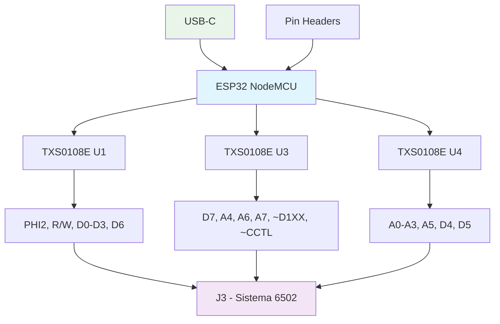
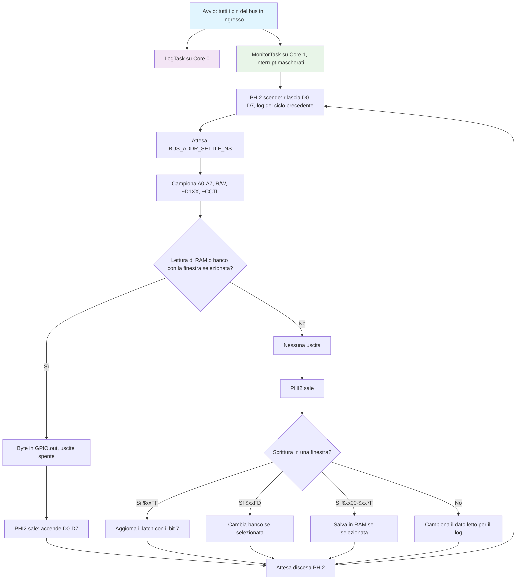
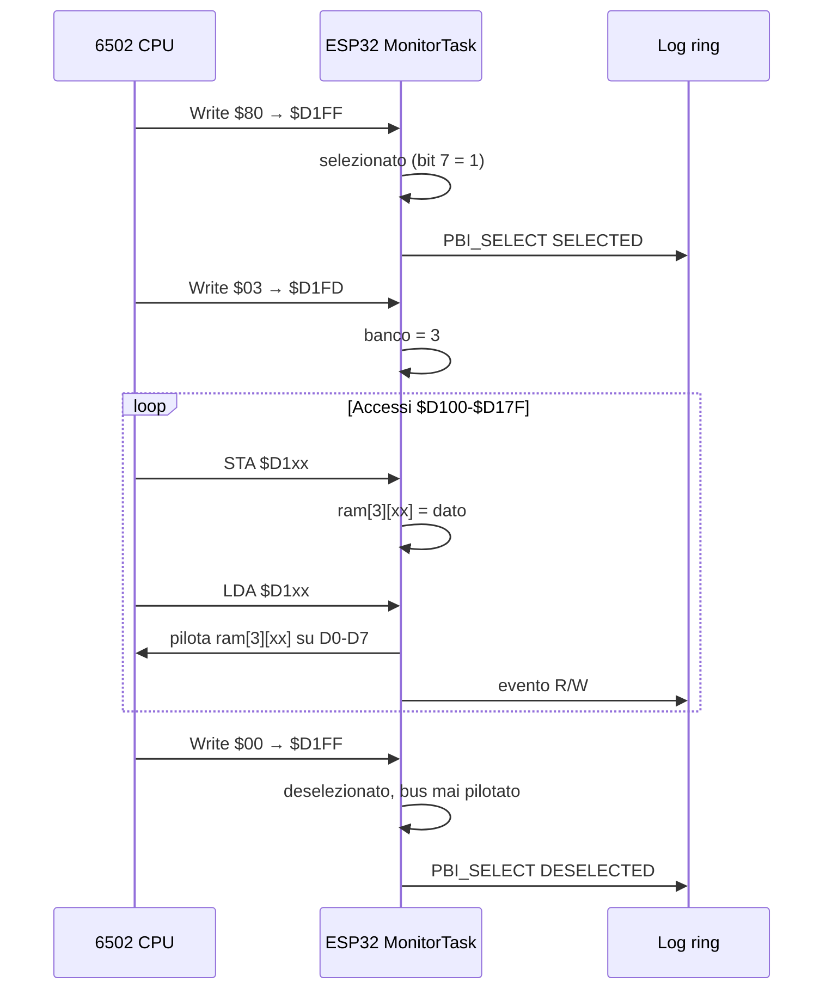

# ESP32-BOBOARD-5V

**ESP32 NodeMCU 5V Tolerant Breakout Board per Monitoraggio Bus 6502**

## 🌐 Language / Lingua

[](README.md)
[](README_EN.md)

---


## 📋 Indice

- [Panoramica del Progetto](#panoramica-del-progetto)
- [Caratteristiche Principali](#caratteristiche-principali)
- [Specifiche Tecniche](#specifiche-tecniche)
- [Visualizzazione 3D](#visualizzazione-3d)
- [Architettura Hardware](#architettura-hardware)
- [Firmware](#firmware)
- [Installazione e Setup](#installazione-e-setup)
- [Utilizzo](#utilizzo)
- [Diagrammi di Flusso](#diagrammi-di-flusso)
- [Tempistiche](#tempistiche)
- [File del Progetto](#file-del-progetto)
- [Produzione](#produzione)
- [Licenza](#licenza)
- [Contributi](#contributi)

## 🎯 Panoramica del Progetto

ESP32-BOBOARD-5V è una scheda breakout specializzata progettata per interfacciare un modulo ESP32 NodeMCU con sistemi basati su processore 6502, come l'Atari 8-bit. La scheda fornisce:

- **Tolleranza 5V** per tutti i pin GPIO
- **Monitoraggio del bus 6502** in tempo reale
- **Implementazione PBI (Parallel Bus Interface)** per Atari
- **Level shifting bidirezionale** per compatibilità 3.3V/5V
- **Connettori standard** per facile integrazione

### 🎮 Applicazioni Principali

- Monitoraggio e debug di sistemi 6502
- Implementazione di periferiche PBI per Atari
- Analisi del traffico del bus dati/indirizzi
- Espansioni RAM a banchi nell'area I/O ($D1xx / $D5xx)
- Sviluppo di cartucce intelligenti

## ✨ Caratteristiche Principali

### Hardware
- **ESP32 NodeMCU** compatibile (240MHz dual-core)
- **3x TXS0108E** level shifters bidirezionali
- **Tolleranza 5V** su tutti i pin GPIO
- **Connettore USB-C** per programmazione e alimentazione
- **Connettore PBI** standard per Atari
- **Pin header** per accesso completo ai GPIO
- **LED di stato** e pulsanti di controllo

### Firmware
- **RAM a banchi PBI / CCTL senza ROM**: due finestre indipendenti, $D100–$D1FF (`~D1XX`) e $D500–$D5FF (`~CCTL`), decodificate dalla MMU/PLA dell'Atari; solo A0–A7 campionati
- **Per finestra**: RAM a $xx00–$xx7F (128 byte del banco corrente), registro del banco a $xxFD (256 banchi, 32 KB per finestra nella DRAM dell'ESP32), latch di selezione a $xxFF (bit 7, ID dispositivo `$80`); da non selezionato non pilota mai il bus
- **Nessuna ROM, nessun MPD / EXTSEL**: tutti i pin del bus sono ingressi, D0–D7 diventano uscite solo per rispondere a una lettura
- **Dual-core**: Core 1 dedicato al bus (interrupt mascherati, decodifica durante PHI1), Core 0 stampa il log
- **Log lock-free** (Core 1 → Core 0): ogni accesso alle due finestre e ogni cambio di latch, con timestamp in microsecondi

## 🔧 Specifiche Tecniche

| Parametro | Valore |
|-----------|--------|
| **Microcontrollore** | ESP32-WROOM-32 |
| **Frequenza CPU** | 240 MHz (dual-core) |
| **Memoria Flash** | 4MB |
| **RAM** | 520KB |
| **GPIO disponibili** | 30 pin |
| **Level Shifters** | 3x TXS0108E (8-bit bidirezionali) |
| **Alimentazione** | 5V via USB-C o pin |
| **Logica I/O** | 3.3V/5V tolerant |
| **Dimensioni PCB** | 21.7mm x 21.7mm |
| **Layers** | 4 layer PCB |

### Pinout 6502 Bus

| Segnale | Pin ESP32 | Descrizione |
|---------|-----------|-------------|
| **D0-D7** | GPIO4, GPIO5, GPIO13, GPIO14, GPIO16, GPIO17, GPIO18, GPIO19 | Data Bus (Bidirezionale) |
| **A0-A3** | GPIO34, GPIO35, GPIO36, GPIO39 | Address Bus LSB (Input Only) |
| **A4-A7** | GPIO32, GPIO33, GPIO21, GPIO27 | Address Bus |
| **PHI2** | GPIO2 | Clock 6502 (1.79 MHz) |
| **R/W** | GPIO15 | Read/Write |
| **~D1XX** | GPIO22 | Finestra $D100–$D1FF, dalla MMU/PLA (Active Low, Input) |
| **~CCTL** | GPIO23 | Finestra $D500–$D5FF, dalla MMU/PLA (Active Low, Input) |
| **TX debug** | GPIO1 | Console seriale 115200 bps (anche su J4 pin 3) |

Non usati dal firmware: GPIO12 (ancora collegato a U1 / J3 pin 4, pin di strapping), GPIO25 e GPIO26 (canali TXS0108E liberi), GPIO0 e GPIO3 (non portati su J3).

## 🎨 Visualizzazione 3D

### 📱 Viewer Online Interattivi

Visualizza i modelli 3D direttamente nel browser:

[](https://viewer.cadexchanger.com/)

[](https://3dviewer.net/?file=https://raw.githubusercontent.com/gianlucarenzi/esp32-boboard-5v/main/3D/ESP32-BOBOARD-5V.step)

[](https://viewer.autodesk.com/)


### 📥 Download File 3D

| Formato | Descrizione | Download |
|---------|-------------|----------|
| **STEP** | Modello CAD parametrico | [](3D/ESP32-BOBOARD-5V.step) |
| **WRL** | Modello VRML per rendering | [](3D/ESP32-BOBOARD-5V.wrl) |

### 🖼️ Galleria Immagini 3D

<table>
  <tr>
    <td align="center">
      
      <br/><b>Vista Isometrica</b>
    </td>
    <td align="center">
      
      <br/><b>Vista Superiore</b>
    </td>
  </tr>
  <tr>
    <td align="center">
      
      <br/><b>Vista Inferiore</b>
    </td>
    <td align="center">
      
      <br/><b><a href="schematics/ESP32-BOBOARD-5V.pdf">📄 Schema Elettrico</a></b>
    </td>
  </tr>
</table>

### 🛠️ Software Consigliati per Visualizzazione

| Software | Formato | Piattaforma | Gratuito |
|----------|---------|-------------|----------|
| **FreeCAD** | STEP, WRL | Windows, Linux, macOS | ✅ |
| **Fusion 360** | STEP | Windows, macOS | ✅ (Personal) |
| **Blender** | WRL | Windows, Linux, macOS | ✅ |
| **MeshLab** | WRL | Windows, Linux, macOS | ✅ |
| **CAD Exchanger Viewer** | STEP, WRL | Browser | ✅ |
| **3D Viewer Online** | STEP, WRL | Browser | ✅ |
| **Autodesk Viewer** | STEP | Browser | ✅ |

---

## 🏗️ Architettura Hardware

### Schema a Blocchi



### Level Shifting

La scheda utilizza tre TXS0108E per garantire la compatibilità tra i livelli logici 3.3V dell'ESP32 e i 5V del sistema 6502.  I canali seguono i pin del modulo, non le funzioni:

- **U1**: PHI2 (GPIO2), D0 (GPIO4), D1 (GPIO5), GPIO12 (non usato), D2 (GPIO13), D3 (GPIO14), R/W (GPIO15), D6 (GPIO18)
- **U3**: D7 (GPIO19), A6 (GPIO21), ~D1XX (GPIO22), ~CCTL (GPIO23), GPIO25 e GPIO26 (liberi), A7 (GPIO27), A4 (GPIO32)
- **U4**: A5 (GPIO33), A0 (GPIO34), A1 (GPIO35), A2 (GPIO36), A3 (GPIO39), D4 (GPIO16), D5 (GPIO17); canale 8 libero

`TXS_EN` (OE di tutti e tre) è tenuto alto da R1/R3/R4; SW1 lo porta a GND per isolare l'ESP32 dal bus.

## 💻 Firmware

### Architettura Software

Il firmware è basato su FreeRTOS e utilizza entrambi i core dell'ESP32:

- **Core 0**: `LogTask`, unico scrittore sulla seriale
- **Core 1**: `MonitorTask` in IRAM, con interrupt mascherati e watchdog degli interrupt disattivato, possiede il bus 6502

### Funzionalità Principali

#### 1. Ciclo di bus

- **PHI1**: 200 ns dopo la discesa di PHI2 (`BUS_ADDR_SETTLE_NS`) campiona A0–A7, R/W, `~D1XX` e `~CCTL`; per una lettura della RAM o del registro del banco di una finestra selezionata scrive il byte in `GPIO.out` con le uscite ancora spente
- **Salita di PHI2**: un solo store accende D0–D7; se la selezione compare solo sul fronte di salita, il byte viene pilotato in ritardo
- **Scrittura**: il dato è campionato 120 ns dopo la salita di PHI2 (`BUS_WR_SAMPLE_NS`)
- **Discesa di PHI2**: D0–D7 rilasciati; l'evento del ciclo va nel log durante la PHI1 successiva

#### 2. RAM a banchi PBI / CCTL

Le due finestre sono indipendenti: ognuna ha il proprio latch, il proprio registro del banco e la propria RAM.

| Offset | Funzione | Note |
|--------|----------|------|
| **$00–$7F** | Finestra RAM (128 byte del banco corrente) | Lettura e scrittura solo con la finestra selezionata |
| **$80–$FC** | Riservato | Mai pilotato, scritture ignorate |
| **$FD** | Registro del banco (R/W, 0–255) | 256 banchi × 128 byte = 32 KB per finestra |
| **$FE** | Riservato | |
| **$FF** | Latch di selezione (W: bit 7) | Mai pilotato in lettura ($D1FF è lo stato IRQ PBI) |

Indirizzo lineare nella RAM di una finestra: banco = indirizzo >> 7, offset = indirizzo & $7F.  Un ciclo su tutta la finestra: `LDX #$7F` / `LDA $D100,X` / … / `DEX` / `BPL`.  All'accensione: non selezionata, banco 0, RAM a `$00`; la RAM non si conserva al reset dell'ESP32.  Senza ROM la scansione PBI dell'OS non trova la firma a $D803 / $D80B e salta il dispositivo: i programmi lo selezionano direttamente scrivendo `$80` in $D1FF / $D5FF.

## 🚀 Installazione e Setup

### Requisiti Hardware
- ESP32 NodeMCU DevKit V1 (30 pin, ESP32-WROOM-32)
- Cavo USB-C per programmazione
- Sistema 6502 target (es. Atari 130XE)
- Connessioni bus secondo pinout

### Requisiti Software
- [PlatformIO](https://platformio.org/) o Arduino IDE
- ESP32 Arduino Core v2.0.14
- Driver USB-C per il sistema operativo

### Compilazione Firmware

1. **Clone del repository**:
```bash
git clone https://github.com/gianlucarenzi/esp32-boboard-5v.git
cd ESP32-BOBOARD-5V/firmware/6502_monitor
```

2. **Configurazione PlatformIO** (estratto di `platformio.ini`):
```ini
[env]
extra_scripts = post:efuse_vdd_sdio.py
monitor_rts = 0
monitor_dtr = 0
custom_efuse_vdd_sdio = 3.3V

[env:nodemcu-32s]
platform = espressif32@6.6.0
board = nodemcu-32s
framework = arduino
monitor_speed = 115200
upload_speed = 921600
board_build.f_cpu = 240000000
```

Il modulo si programma **sempre scollegato dall'Atari**, collegato solo al PC.  Prima di ogni upload `efuse_vdd_sdio.py` verifica gli efuse VDD_SDIO e, se sono vergini, li programma a 3,3 V (**irreversibile**), così GPIO12 non viene più letto al reset.

3. **Compilazione e upload**:
```bash
pio run --target upload
pio device monitor
```

### Configurazione Hardware

1. **Connessione ESP32**: Inserire il modulo NodeMCU nei socket
2. **Alimentazione**: Collegare USB-C o alimentazione 5V
3. **Bus 6502**: Collegare secondo il pinout specificato
4. **Test**: Eseguire modalità test per verifica connessioni

## 📊 Utilizzo

### Avvio Sistema

1. **Power-on**: Alimentare la scheda
2. **Monitor seriale**: Aprire terminale a 115200 baud
3. **Inizializzazione**: Attendere messaggio di ready
4. **Connessione 6502**: Collegare al sistema target

### Output Seriale

Il firmware stampa su Core 0 ogni evento registrato da Core 1 in un ring buffer lock-free.
Il formato è `[secondi.microsecondi]`:

```
[6502_monitor] Banked RAM PBI / CCTL peripheral, device ID $80
[6502_monitor] $D100-$D17F / $D500-$D57F: 256 banks x 128 bytes per window, bank $xxFD, select $xxFF
[6502_monitor] Bus loop on Core 1 (settle 200 ns, write sample 120 ns), log 115200 baud
[    1.234567] [D1FF - PBI_SELECT          ] W $80  device SELECTED
[    1.234601] [D1FD - BANK_SELECT         ] W $03  SEL
[    1.234640] [D105 - RAM bank $03 +$05   ] W $AA  SEL
[    1.234680] [D105 - RAM bank $03 +$05   ] R $AA  SEL DRV
[    1.300000] [D500 - RAM bank $00 +$00   ] R $FF  -
```

- `PBI_SELECT` / `CCTL_SELECT` — scrittura del latch e nuovo stato: `SELECTED` / `DESELECTED`
- `SEL` = dispositivo selezionato in quella finestra, `DRV` = byte pilotato dal dispositivo, `-` = non selezionato (il byte è quello presente sul bus)
- Gli offset sono mostrati come `RAM bank $bb +$oo`, `BANK_SELECT`, `PBI_SELECT` / `CCTL_SELECT` o `RESERVED`
- Il timestamp viene dal contatore di cicli del Core 1 (CCOUNT esteso a 64 bit)
- Ogni riga è una sola `Serial.write()`: le righe non si mescolano mai; gli eventi persi quando il ring è pieno vengono contati
- Debug in sola lettura anche su J4: GND (pin 1) e TX0 (pin 3, 3,3 V); RX0 (pin 2) va lasciato scollegato

## 📈 Diagrammi di Flusso

### Flusso Principale del Monitor



### Protocollo di Selezione (PBI)



## ⏱️ Tempistiche

### Timing Critici

| Operazione | Tempo | Note |
|------------|-------|------|
| **PHI2 Period** | 1.77 MHz (PAL) / 1.79 MHz (NTSC) | Clock Atari 6502 |
| **Address Setup** | <100ns | Prima del rising edge PHI2 |
| **Data Setup** | <200ns | Per operazioni di write |
| **Data Hold** | <100ns | Dopo falling edge PHI2 |
| **GPIO Read** | ~125ns | Lettura registri ESP32 |
| **Level Shift** | <10ns | Propagazione TXS0108E |

### Diagramma Temporale Bus 6502

```mermaid
gantt
    title Timing Diagram - 6502 Bus Cycle
    dateFormat X
    axisFormat %L
    
    section PHI2
    High Phase    :active, phi2h, 0, 500
    Low Phase     :phi2l, 500, 1000
    
    section Address Bus
    Address Valid :addr, 0, 900
    Address Hold  :addrh, 900, 1000
    
    section Data Bus (Read)
    Data Setup    :data, 100, 400
    Data Valid    :active, datav, 400, 800
    Data Hold     :datah, 800, 900
    
    section R/W Signal
    Read Cycle    :active, rw, 0, 1000
```



### Performance del Monitor

- **Campionamento**: un ciclo di bus per volta, Core 1 dedicato al 100%
- **Risposta in lettura**: byte (RAM del banco o registro del banco) preparato durante PHI1, uscite accese subito dopo la salita di PHI2 (da misurare all'oscilloscopio)
- **Throughput seriale**: 115200 baud per debug (`LOG_BAUD`)
- **Compatibilità**: Atari PAL (1.77 MHz) e NTSC (1.79 MHz)

## 📁 File del Progetto

### Struttura Directory

```
ESP32-BOBOARD-5V/
├── 📁 firmware/
│   └── 📁 6502_monitor/
│       ├── 📄 platformio.ini          # Configurazione PlatformIO (un solo ambiente: nodemcu-32s)
│       ├── 📄 efuse_vdd_sdio.py       # Controllo/programmazione efuse VDD_SDIO prima di ogni upload
│       ├── 📁 src/
│       │   └── 📄 main.cpp            # Firmware ESP32 (RAM a banchi PBI/CCTL + monitor)
│       ├── 📄 README.md, HARDWARE.md, PIN_MAPPING.md/.tex/.pdf, Logs.md
├── 📁 schematics/
│   └── 📄 ESP32-BOBOARD-5V.pdf    # Schema elettrico
├── 📁 3D/
│   ├── 🖼️ ESP32-BOBOARD-5V.png    # Render 3D
│   ├── 🖼️ ESP32-BOBOARD-5V_TOP.png
│   ├── 🖼️ ESP32-BOBOARD-5V_BOTTOM.png
│   └── 📄 ESP32-BOBOARD-5V.step   # Modello 3D
├── 📁 production/
│   ├── 📄 *.gbl, *.gtl           # File Gerber
│   ├── 📄 *.drl                  # File drill
│   └── 📄 ESP32BOBOARD-5V-1.0.zip
├── 📁 ibom/
│   └── 📄 ibom.html              # Interactive BOM
├── 📄 ESP32-BOBOARD-5V.kicad_pcb  # PCB KiCad
├── 📄 ESP32-BOBOARD-5V.sch        # Schema KiCad
├── 📄 ESP32-BOBOARD-5V.csv        # Bill of Materials
└── 📄 README.md                   # Questo file
```

### File di Produzione

#### Bill of Materials (BOM)

| Componente | Quantità | Package | LCSC Part |
|------------|----------|---------|-----------|
| **TXS0108EPW** | 3 | TSSOP-20 | C17206 |
| **100µF Capacitor** | 9 | 0805 | C141660 |
| **100nF Capacitor** | 1 | 0805 | C840116 |
| **10kΩ Resistor** | 4 | 0805 | C84376 |
| **5.1kΩ Resistor** | 2 | 0805 | C27834 |
| **1% Precision Resistor** | 2 | 0805 | C328378 |
| **Pin Socket 1x15** | 2 | THT | - |
| **Pin Header 2x16** | 1 | SMD | C6332241 |
| **USB-C Connector** | 1 | SMD | C3197885 |
| **SPST Switch** | 1 | SMD | C319052 |

#### File Gerber
- **4-layer PCB** ottimizzato per segnali ad alta velocità
- **Impedenza controllata** per linee critiche
- **Ground planes** per riduzione EMI
- **Via stitching** per integrità del segnale

## 🏭 Produzione

### Specifiche PCB

| Parametro | Valore |
|-----------|--------|
| **Layers** | 4 |
| **Thickness** | 1.6mm |
| **Min Track** | 0.1mm |
| **Min Via** | 0.2mm |
| **Copper Weight** | 1oz (35μm) |
| **Surface Finish** | HASL Lead-Free |
| **Solder Mask** | Green |
| **Silkscreen** | White |

### Assembly

1. **SMD Components**: Assemblaggio automatico raccomandato
2. **THT Components**: Saldatura manuale pin headers
3. **Test**: Verifica continuità e test funzionale
4. **Programming**: Upload firmware di test

## 📜 Licenza

Questo progetto è rilasciato sotto **GNU General Public License v3.0**.

```
ESP32-BOBOARD-5V - ESP32 NodeMCU 5V Tolerant Breakout Board
Copyright (C) 2024 RetroBitLab

This program is free software: you can redistribute it and/or modify
it under the terms of the GNU General Public License as published by
the Free Software Foundation, either version 3 of the License, or
(at your option) any later version.
```

Vedi il file [LICENSE](LICENSE) per i dettagli completi.

## 🤝 Contributi

I contributi sono benvenuti! Per contribuire:

1. **Fork** del repository
2. **Crea** un branch per la tua feature (`git checkout -b feature/AmazingFeature`)
3. **Commit** delle modifiche (`git commit -m 'Add some AmazingFeature'`)
4. **Push** al branch (`git push origin feature/AmazingFeature`)
5. **Apri** una Pull Request

### Aree di Contributo

- 🐛 **Bug fixes** e miglioramenti firmware
- 📚 **Documentazione** e tutorial
- 🔧 **Hardware** ottimizzazioni e varianti
- 🧪 **Testing** e validazione
- 🎨 **Examples** e progetti dimostrativi

### Reporting Issues

Per segnalare problemi, utilizzare il sistema di [Issues](../../issues) includendo:
- Descrizione dettagliata del problema
- Versione hardware e firmware
- Log seriali se disponibili
- Passi per riprodurre il problema

---

## 📞 Contatti

- **Progetto**: ESP32-BOBOARD-5V
- **Autore**: RetroBitLab
Repository: [GitHub](https://github.com/gianlucarenzi/esp32-boboard-5v)
- **Documentazione**: [Wiki](../../wiki)

---

*Realizzato con ❤️ per la comunità retro-computing*