# ESP32-BOBOARD-5V

**ESP32 NodeMCU 5V Tolerant Breakout Board per Monitoraggio Bus 6502**

## 🌐 Language / Lingua

[](README.md)
[](README_EN.md)

---

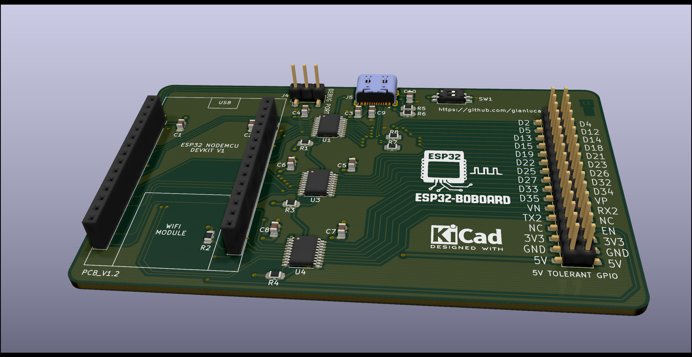

## 📋 Indice

- [Panoramica del Progetto](#panoramica-del-progetto)
- [Caratteristiche Principali](#caratteristiche-principali)
- [Specifiche Tecniche](#specifiche-tecniche)
- [Visualizzazione 3D](#visualizzazione-3d)
- [Architettura Hardware](#architettura-hardware)
- [Firmware](#firmware)
- [Installazione e Setup](#installazione-e-setup)
- [Utilizzo](#utilizzo)
- [Diagrammi di Flusso](#diagrammi-di-flusso)
- [Tempistiche](#tempistiche)
- [File del Progetto](#file-del-progetto)
- [Produzione](#produzione)
- [Licenza](#licenza)
- [Contributi](#contributi)

## 🎯 Panoramica del Progetto

ESP32-BOBOARD-5V è una scheda breakout specializzata progettata per interfacciare un modulo ESP32 NodeMCU con sistemi basati su processore 6502, come l'Atari 8-bit. La scheda fornisce:

- **Tolleranza 5V** per tutti i pin GPIO
- **Monitoraggio del bus 6502** in tempo reale
- **Implementazione PBI (Parallel Bus Interface)** per Atari
- **Level shifting bidirezionale** per compatibilità 3.3V/5V
- **Connettori standard** per facile integrazione

### 🎮 Applicazioni Principali

- Monitoraggio e debug di sistemi 6502
- Implementazione di periferiche PBI per Atari
- Analisi del traffico del bus dati/indirizzi
- Espansione RAM a pagine da oltre 200 KB per Atari 130XE, finestra da 256 byte in $D500 (in stile GeoRAM)
- Espansione RAM 256 KB compatibile GeoRAM per Commodore 64, sulla porta di espansione (ambiente `c64`)
- Sviluppo di cartucce intelligenti

## ✨ Caratteristiche Principali

### Hardware
- **ESP32 NodeMCU** compatibile (240MHz dual-core)
- **3x TXS0108E** level shifters bidirezionali
- **Tolleranza 5V** su tutti i pin GPIO
- **Connettore USB-C** per programmazione e alimentazione
- **Connettore PBI** standard per Atari
- **Pin header** per accesso completo ai GPIO
- **LED di stato** e pulsanti di controllo

### Firmware
- **Espansione RAM a pagine da oltre 200 KB per Atari 130XE, in stile GeoRAM, senza ROM**: registri in $D100–$D1FF (`~D1XX`) e finestra RAM in $D500–$D5FF (`~CCTL`), decodificate dalla MMU/PLA dell'Atari; solo A0–A7 campionati
- **Ruoli fissi**: finestra RAM di 256 byte in $D500–$D5FF; registri in $D1xx: numero di banchi a $D1FB–$D1FC (sola lettura), registro del banco a 16 bit a $D1FD–$D1FE, latch di selezione PBI a $D1FF (bit 7, ID dispositivo `$80`); da non selezionato non pilota mai il bus
- **Banchi dall'heap**: all'avvio il firmware prende la DRAM libera dell'ESP32 in banchi da 256 byte (stima 200–230 KB, il valore esatto è stampato all'avvio)
- **Espansione RAM 256 KB compatibile GeoRAM per C64 (ambiente `c64`)**: la stessa scheda sulla porta di espansione: finestra RAM in IO1 $DE00–$DEFF, pagina in $DFFE e blocco da 16 KB in $DFFF (solo scrittura); /IO1 su J3 pin 12, /IO2 su J3 pin 11; 256 KB (16 blocchi, con ripiegamento degli indirizzi come una GeoRAM vera: circa 210 KB dalla DRAM e il resto dall'IRAM dell'ESP32)
- **Nessuna ROM, nessun MPD / EXTSEL**: tutti i pin del bus sono ingressi, D0–D7 diventano uscite solo per rispondere a una lettura
- **Dual-core**: Core 1 dedicato al bus (interrupt mascherati, decodifica durante PHI1), Core 0 stampa il log
- **Log lock-free** (Core 1 → Core 0): ogni accesso alle due pagine e ogni cambio di latch, con timestamp in microsecondi

## 🔧 Specifiche Tecniche

| Parametro | Valore |
|-----------|--------|
| **Microcontrollore** | ESP32-WROOM-32 |
| **Frequenza CPU** | 240 MHz (dual-core) |
| **Memoria Flash** | 4MB |
| **RAM** | 520KB |
| **GPIO disponibili** | 30 pin |
| **Level Shifters** | 3x TXS0108E (8-bit bidirezionali) |
| **Alimentazione** | 5V via USB-C o pin |
| **Logica I/O** | 3.3V/5V tolerant |
| **Dimensioni PCB** | 21.7mm x 21.7mm |
| **Layers** | 4 layer PCB |

### Pinout 6502 Bus

| Segnale | Pin ESP32 | Descrizione |
|---------|-----------|-------------|
| **D0-D7** | GPIO4, GPIO5, GPIO13, GPIO14, GPIO16, GPIO17, GPIO18, GPIO19 | Data Bus (Bidirezionale) |
| **A0-A3** | GPIO34, GPIO35, GPIO36, GPIO39 | Address Bus LSB (Input Only) |
| **A4-A7** | GPIO32, GPIO33, GPIO21, GPIO27 | Address Bus |
| **PHI2** | GPIO2 | Clock 6502 (1.79 MHz) |
| **R/W** | GPIO15 | Read/Write |
| **~D1XX** | GPIO22 | Pagina $D100–$D1FF, dalla MMU/PLA (Active Low, Input) |
| **~CCTL** | GPIO23 | Pagina $D500–$D5FF, dalla MMU/PLA (Active Low, Input) |
| **TX debug** | GPIO1 | Console seriale 115200 bps (anche su J4 pin 3) |

Non usati dal firmware: GPIO12 (ancora collegato a U1 / J3 pin 4, pin di strapping), GPIO25 e GPIO26 (canali TXS0108E liberi), GPIO0 e GPIO3 (non portati su J3).

## 🎨 Visualizzazione 3D

### 📱 Viewer Online Interattivi

Visualizza i modelli 3D direttamente nel browser:

[](https://viewer.cadexchanger.com/)

[](https://3dviewer.net/?file=https://raw.githubusercontent.com/gianlucarenzi/esp32-boboard-5v/main/3D/ESP32-BOBOARD-5V.step)

[](https://viewer.autodesk.com/)


### 📥 Download File 3D

| Formato | Descrizione | Download |
|---------|-------------|----------|
| **STEP** | Modello CAD parametrico | [](3D/ESP32-BOBOARD-5V.step) |
| **WRL** | Modello VRML per rendering | [](3D/ESP32-BOBOARD-5V.wrl) |

### 🖼️ Galleria Immagini 3D

<table>
  <tr>
    <td align="center">
      
      <br/><b>Vista Isometrica</b>
    </td>
    <td align="center">
      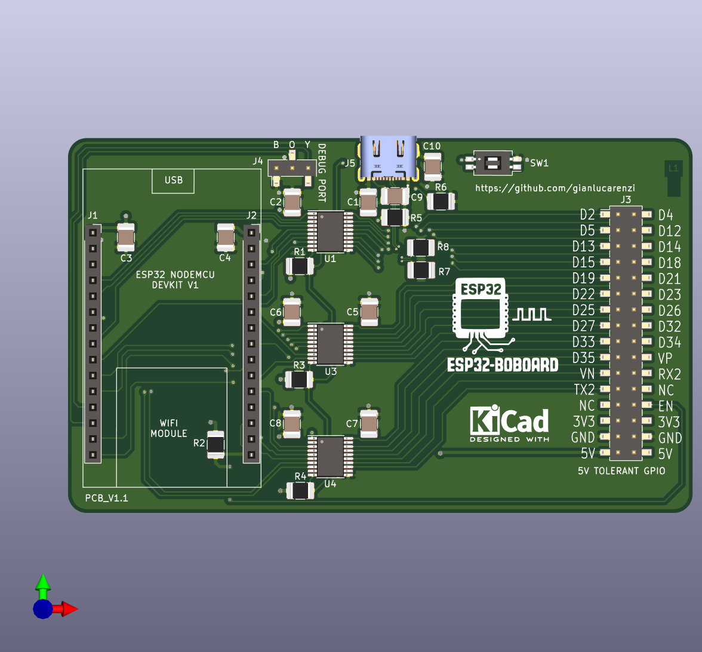
      <br/><b>Vista Superiore</b>
    </td>
  </tr>
  <tr>
    <td align="center">
      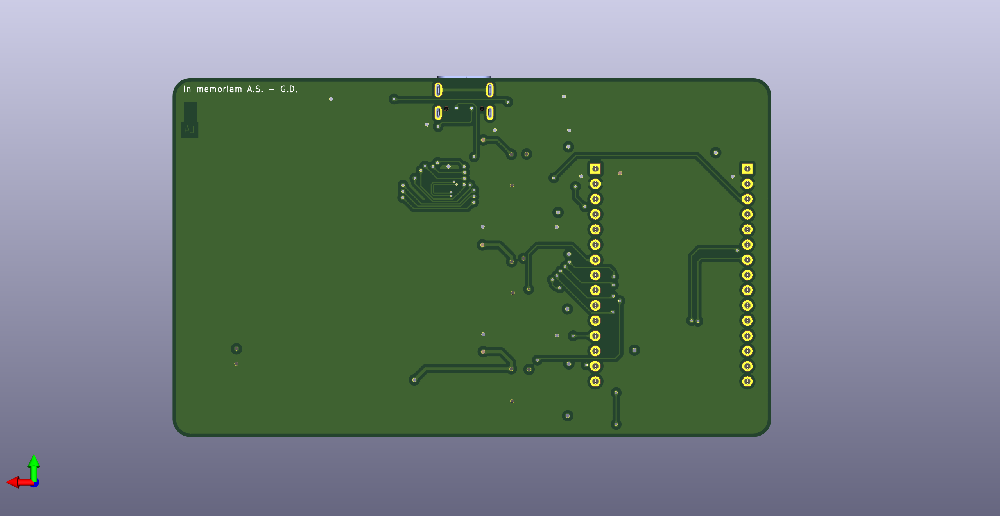
      <br/><b>Vista Inferiore</b>
    </td>
    <td align="center">
      
      <br/><b><a href="schematics/ESP32-BOBOARD-5V.pdf">📄 Schema Elettrico</a></b>
    </td>
  </tr>
</table>

### 🛠️ Software Consigliati per Visualizzazione

| Software | Formato | Piattaforma | Gratuito |
|----------|---------|-------------|----------|
| **FreeCAD** | STEP, WRL | Windows, Linux, macOS | ✅ |
| **Fusion 360** | STEP | Windows, macOS | ✅ (Personal) |
| **Blender** | WRL | Windows, Linux, macOS | ✅ |
| **MeshLab** | WRL | Windows, Linux, macOS | ✅ |
| **CAD Exchanger Viewer** | STEP, WRL | Browser | ✅ |
| **3D Viewer Online** | STEP, WRL | Browser | ✅ |
| **Autodesk Viewer** | STEP | Browser | ✅ |

---

## 🏗️ Architettura Hardware

### Schema a Blocchi

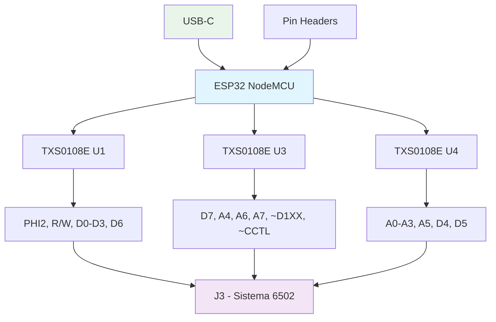

### Level Shifting

La scheda utilizza tre TXS0108E per garantire la compatibilità tra i livelli logici 3.3V dell'ESP32 e i 5V del sistema 6502.  I canali seguono i pin del modulo, non le funzioni:

- **U1**: PHI2 (GPIO2), D0 (GPIO4), D1 (GPIO5), GPIO12 (non usato), D2 (GPIO13), D3 (GPIO14), R/W (GPIO15), D6 (GPIO18)
- **U3**: D7 (GPIO19), A6 (GPIO21), ~D1XX (GPIO22), ~CCTL (GPIO23), GPIO25 e GPIO26 (liberi), A7 (GPIO27), A4 (GPIO32)
- **U4**: A5 (GPIO33), A0 (GPIO34), A1 (GPIO35), A2 (GPIO36), A3 (GPIO39), D4 (GPIO16), D5 (GPIO17); canale 8 libero

`TXS_EN` (OE di tutti e tre) è tenuto alto da R1/R3/R4; SW1 lo porta a GND per isolare l'ESP32 dal bus.

## 💻 Firmware

### Architettura Software

Il firmware è basato su FreeRTOS e utilizza entrambi i core dell'ESP32:

- **Core 0**: `LogTask`, unico scrittore sulla seriale
- **Core 1**: `MonitorTask` in IRAM, con interrupt mascherati e watchdog degli interrupt disattivato, possiede il bus 6502

### Funzionalità Principali

#### 1. Ciclo di bus

- **PHI1**: 200 ns dopo la discesa di PHI2 (`BUS_ADDR_SETTLE_NS`) campiona A0–A7, R/W, `~D1XX` e `~CCTL`; per una lettura della finestra RAM o di un registro ($D1FB–$D1FE) scrive il byte in `GPIO.out` con le uscite ancora spente
- **Salita di PHI2**: un solo store accende D0–D7; se la selezione compare solo sul fronte di salita, il byte viene pilotato in ritardo
- **Scrittura**: il dato è campionato 120 ns dopo la salita di PHI2 (`BUS_WR_SAMPLE_NS`)
- **Discesa di PHI2**: D0–D7 rilasciati; l'evento del ciclo va nel log durante la PHI1 successiva

#### 2. Atari 130XE: espansione RAM a pagine da oltre 200 KB (in stile GeoRAM)

Non è una GeoRAM (sull'Atari non è mai esistita) e non è compatibile con la memoria estesa del 130XE / RAMBO, quella commutata via PORTB in $4000–$7FFF: DOS con RAMdisk e programmi per la memoria estesa non la vedono, serve software scritto per questa mappa.  La quantità esatta (stima 200–230 KB) la stampa il banner all'avvio.

Ruoli fissi, come la GeoRAM del C64 fra IO2 e IO1: la pagina PBI $D1xx contiene i registri, la pagina CCTL $D500–$D5FF è una finestra di 256 byte sulla RAM.

| Indirizzo | Funzione | Note |
|-----------|----------|------|
| **$D500–$D5FF** | Finestra RAM: 256 byte del banco corrente (R/W) | Solo con il dispositivo selezionato |
| **$D1FB–$D1FC** | Numero di banchi (R, 16 bit) | Dipende dall'heap libero, scritture ignorate |
| **$D1FD–$D1FE** | Registro del banco (R/W, 16 bit, little-endian) | Un banco oltre il numero disponibile non risponde |
| **$D1FF** | Latch di selezione PBI (W: bit 7 = ID `$80`) | Mai pilotato in lettura ($D1FF è lo stato IRQ PBI) |
| **$D100–$D1FA** | Riservato | Mai pilotato, scritture ignorate |

Regole PBI: una scrittura in $D1FF seleziona il dispositivo con il bit 7 a 1 e lo deseleziona con il bit 7 a 0 (ogni dispositivo PBI guarda solo il proprio bit).  Da non selezionato non pilota mai il bus e ignora ogni scrittura tranne il latch.

Collegamento all'Atari 130XE (slot cartuccia ed ECI).  Sull'800XL il connettore PBI non porta `~D1XX`: $D1xx va decodificato da A8–A15 con logica esterna, non prevista su questa scheda:

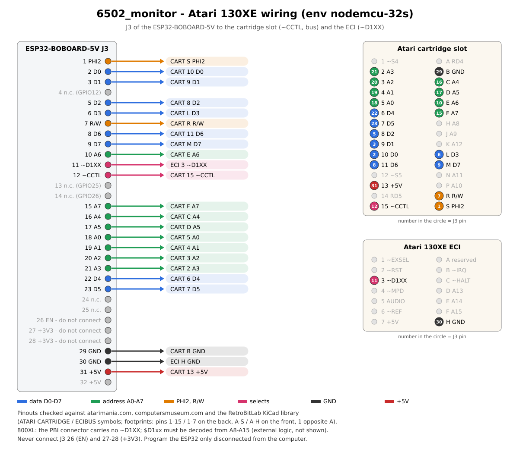

Vista breadboard, stile Fritzing:

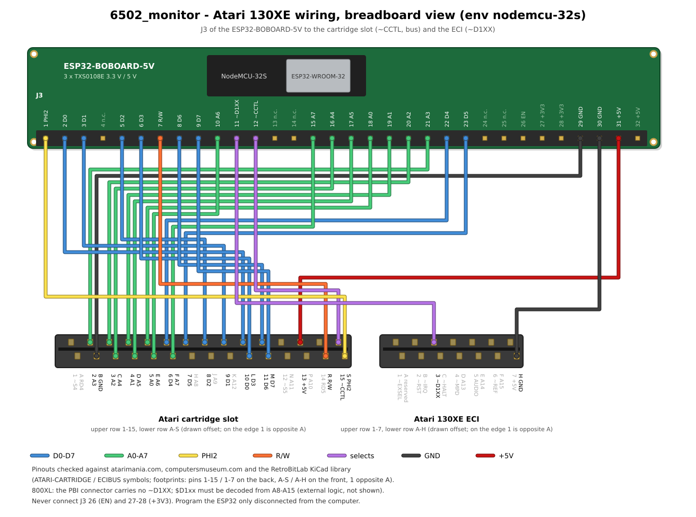

I banchi da 256 byte vengono allocati all'avvio dall'heap DRAM libero dell'ESP32 (meno 24 KB di riserva per il sistema).  Indirizzo lineare: banco = indirizzo >> 8, offset = indirizzo & $FF.  All'accensione: non selezionato, banco 0, RAM a `$00`; il dispositivo non vede il RESET dell'Atari e mantiene lo stato, la RAM non si conserva al reset dell'ESP32.  Senza ROM la scansione PBI dell'OS non trova la firma a $D803 / $D80B e salta il dispositivo: i programmi lo selezionano direttamente scrivendo `$80` in $D1FF; la scansione scrive `$80` e poi `$00` in $D1FF, quindi il dispositivo resta deselezionato.

#### 3. Commodore 64: espansione RAM 256 KB compatibile GeoRAM (ambiente `c64`)

La stessa scheda, con l'ambiente `c64` (`-D BUS_C64=1`), diventa un'espansione RAM compatibile GeoRAM (stessi registri $DE00, $DFFE, $DFFF) per la porta di espansione del C64, con lo stesso schema del firmware di Vera-Module-RBL-C64.  "geoRAM" era un prodotto di Berkeley Softworks, solo nel taglio da 512 KB: questa è un'espansione compatibile da 256 KB, da confermare con il banner all'avvio.

| Indirizzo | Funzione | Note |
|-----------|----------|------|
| **$DE00–$DEFF** (/IO1) | Finestra di 256 byte sulla RAM | Lettura e scrittura |
| **$DFFE** (/IO2) | Pagina nel blocco (0–63) | Solo scrittura, in lettura non pilotato |
| **$DFFF** (/IO2) | Blocco da 16 KB (0–15) | Solo scrittura, in lettura non pilotato |

- **Sempre attiva**, senza latch, come la cartuccia originale; il resto di IO2 non è decodificato (nessun mirror in $DF80–$DFFD)
- **256 KB, 16 blocchi**: indirizzo = blocco × 16384 + pagina × 256 + offset; il blocco è limitato alla dimensione (il blocco 16 coincide con lo 0) come su una GeoRAM vera, così la rilevazione della dimensione vede una 256 KB.  `-D GEORAM_KB=...` per un'altra potenza di 2
- **Memoria**: circa 210 KB dalla DRAM dell'ESP32 e il resto dall'IRAM libera, letta e scritta solo a 32 bit; se non basta, il firmware scende a 128 KB e lo dice nel banner.  La geoRAM originale era da 512 KB: il software che pretende quel taglio non funziona
- **Ciclo di bus**: il VIC-II possiede il bus durante PHI1, quindi tutto avviene con PHI2 alto: dopo la salita il firmware attende /IO1 o /IO2 per al massimo 200 ns (`IO_QUALIFY_NS`), legge A0–A7 e, in lettura, pilota subito il byte fino alla discesa di PHI2; in scrittura il dato è campionato 300 ns dopo la salita (`BUS_WR_SAMPLE_NS`)
- **Stato**: azzerato all'accensione, mantenuto al reset del C64; la RAM non si conserva al reset dell'ESP32

Collegamento alla porta di espansione (pinout del C64 verificato su c64-wiki.com e retroisle.com):

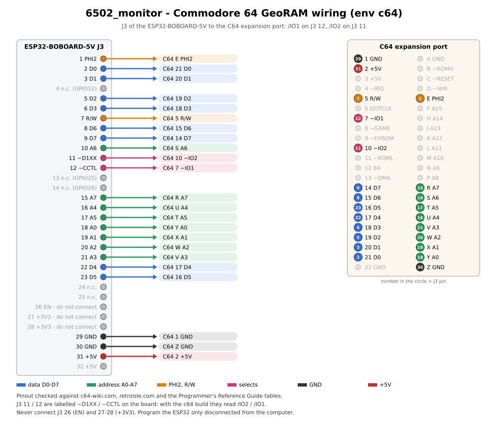

Vista breadboard, stile Fritzing:

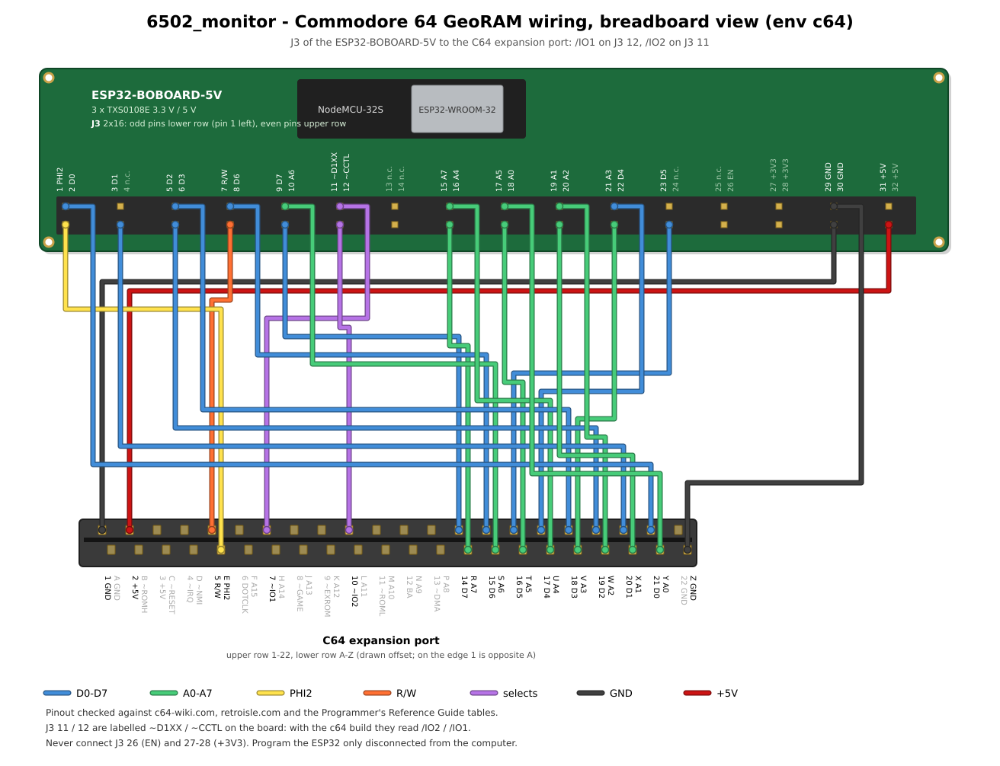


| Segnale | Porta C64 | J3 |
|---------|-----------|----|
| **/IO1** | 7 | 12 (GPIO23, ingresso `~CCTL`) |
| **/IO2** | 10 | 11 (GPIO22, ingresso `~D1XX`) |
| D0 / D1 / D2 / D3 | 21 / 20 / 19 / 18 | 2 / 3 / 5 / 6 |
| D4 / D5 / D6 / D7 | 17 / 16 / 15 / 14 | 22 / 23 / 8 / 9 |
| A0 / A1 / A2 / A3 | Y / X / W / V | 18 / 19 / 20 / 21 |
| A4 / A5 / A6 / A7 | U / T / S / R | 16 / 17 / 10 / 15 |
| Φ2 | E | 1 |
| R/W | 5 | 7 |
| GND | 1, 22, A, Z | 29, 30 |
| +5V | 2, 3 | 31, 32 |

Output seriale (i numeri di pagine e di memoria libera dipendono dalla scheda):

```
[6502_monitor] GeoRAM on the C64 expansion port: 256 KB = 16 blocks x 16 KB
[6502_monitor] Pages: <d> in DRAM, <i> in IRAM, <b> heap blocks; left <h> bytes DRAM, <r> bytes IRAM
[6502_monitor] IO1 $DE00-$DEFF RAM, IO2 $DFFE page, $DFFF block (write-only)
[6502_monitor] /IO1 on J3 pin 12 (GPIO23), /IO2 on J3 pin 11 (GPIO22)
[6502_monitor] Bus loop on Core 1 (/IOx within 200 ns, write sample 300 ns after PHI2 rises), log 115200 baud
[    2.000000] [DFFF - GEORAM_BLOCK        ] W $04  SEL
[    2.000010] [DFFE - GEORAM_PAGE         ] W $23  SEL
[    2.000020] [DE45 - RAM blk $04 pg $23 +$45] R $12  SEL DRV
```

Uso dal C64:
```
LDA #$04 : STA $DFFF   ; blocco 4
LDA #$23 : STA $DFFE   ; pagina 35
LDA $DE45              ; byte GeoRAM $12345
```

Da verificare sull'hardware: il banner (256 KB effettivi), le temporizzazioni all'oscilloscopio e la compatibilità con GEOS e il software GeoRAM.

## 🚀 Installazione e Setup

### Requisiti Hardware
- ESP32 NodeMCU DevKit V1 (30 pin, ESP32-WROOM-32)
- Cavo USB-C per programmazione
- Sistema 6502 target (es. Atari 130XE)
- Connessioni bus secondo pinout

### Requisiti Software
- [PlatformIO](https://platformio.org/) o Arduino IDE
- ESP32 Arduino Core v2.0.14
- Driver USB-C per il sistema operativo

### Compilazione Firmware

1. **Clone del repository**:
```bash
git clone https://github.com/gianlucarenzi/esp32-boboard-5v.git
cd ESP32-BOBOARD-5V/firmware/6502_monitor
```

2. **Configurazione PlatformIO** (estratto di `platformio.ini`):
```ini
[env]
extra_scripts = post:efuse_vdd_sdio.py
monitor_rts = 0
monitor_dtr = 0
custom_efuse_vdd_sdio = 3.3V

[env:nodemcu-32s]
platform = espressif32@6.6.0
board = nodemcu-32s
framework = arduino
monitor_speed = 115200
upload_speed = 921600
board_build.f_cpu = 240000000

[env:c64]                      ; Commodore 64, GeoRAM
extends = env:nodemcu-32s
build_flags = ${env:nodemcu-32s.build_flags} -D BUS_C64=1
```

Il modulo si programma **sempre scollegato dall'Atari o dal C64**, collegato solo al PC.  Prima di ogni upload `efuse_vdd_sdio.py` verifica gli efuse VDD_SDIO e, se sono vergini, li programma a 3,3 V (**irreversibile**), così GPIO12 non viene più letto al reset.

3. **Compilazione e upload**:
```bash
pio run -e nodemcu-32s --target upload   # Atari
pio run -e c64 --target upload           # Commodore 64 (GeoRAM)
pio device monitor
```

### Configurazione Hardware

1. **Connessione ESP32**: Inserire il modulo NodeMCU nei socket
2. **Alimentazione**: Collegare USB-C o alimentazione 5V
3. **Bus 6502**: Collegare secondo il pinout specificato
4. **Test**: Eseguire modalità test per verifica connessioni

## 📊 Utilizzo

### Avvio Sistema

1. **Power-on**: Alimentare la scheda
2. **Monitor seriale**: Aprire terminale a 115200 baud
3. **Inizializzazione**: Attendere messaggio di ready
4. **Connessione 6502**: Collegare al sistema target

### Output Seriale

Il firmware stampa su Core 0 ogni evento registrato da Core 1 in un ring buffer lock-free.
Il formato è `[secondi.microsecondi]`:

```
[6502_monitor] Banked RAM PBI / CCTL peripheral, device ID $80
[6502_monitor] <n> banks x 256 bytes = <k> KB, <b> heap blocks, <h> bytes of heap left
[6502_monitor] RAM window $D500-$D5FF; count $D1FB-$D1FC, bank $D1FD-$D1FE, select $D1FF
[6502_monitor] Bus loop on Core 1 (settle 200 ns, write sample 120 ns), log 115200 baud
[    1.234567] [D1FF - PBI_SELECT          ] W $80  SELECTED
[    1.234601] [D1FD - BANK_SELECT_L       ] W $03  SEL
[    1.234620] [D1FE - BANK_SELECT_H       ] W $01  SEL
[    1.234640] [D505 - RAM bank $0103 +$05 ] W $AA  SEL
[    1.234680] [D505 - RAM bank $0103 +$05 ] R $AA  SEL DRV
[    1.300000] [D105 - RESERVED            ] R $FF  SEL
```

- `PBI_SELECT` — scrittura del latch e nuovo stato: `SELECTED` / `DESELECTED`
- `SEL` = dispositivo selezionato, `DRV` = byte pilotato dal dispositivo, `-` = non selezionato (il byte è quello presente sul bus)
- Gli offset sono mostrati come `RAM bank $bbbb +$oo`, `BANK_COUNT_L/H`, `BANK_SELECT_L/H`, `PBI_SELECT` o `RESERVED`; i numeri di banchi nell'esempio sono indicativi
- Il timestamp viene dal contatore di cicli del Core 1 (CCOUNT esteso a 64 bit)
- Ogni riga è una sola `Serial.write()`: le righe non si mescolano mai; gli eventi persi quando il ring è pieno vengono contati
- Debug in sola lettura anche su J4: GND (pin 1) e TX0 (pin 3, 3,3 V); RX0 (pin 2) va lasciato scollegato

## 📈 Diagrammi di Flusso

### Flusso Principale del Monitor

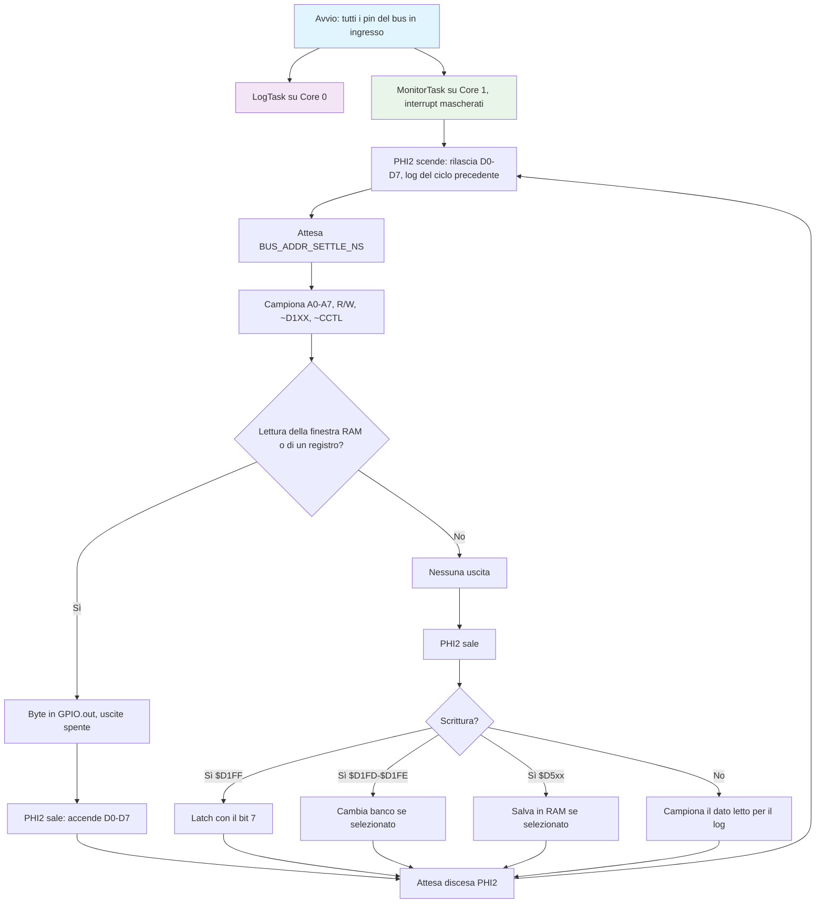

### Protocollo di Selezione (PBI)

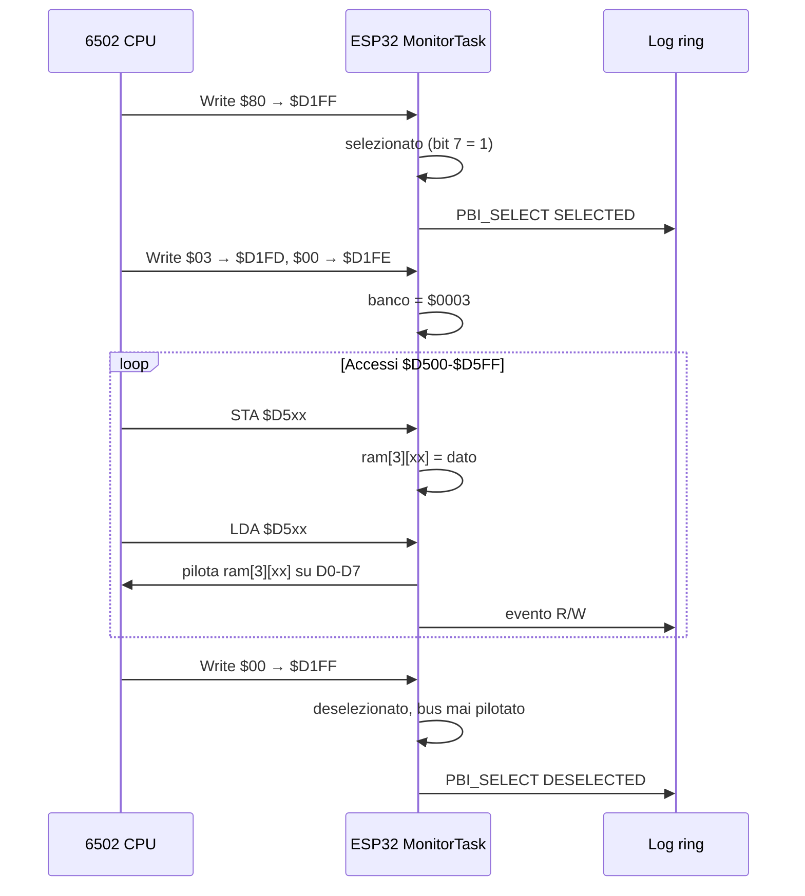

## ⏱️ Tempistiche

### Timing Critici

| Operazione | Tempo | Note |
|------------|-------|------|
| **PHI2 Period** | 1.77 MHz (PAL) / 1.79 MHz (NTSC) | Clock Atari 6502 |
| **Address Setup** | <100ns | Prima del rising edge PHI2 |
| **Data Setup** | <200ns | Per operazioni di write |
| **Data Hold** | <100ns | Dopo falling edge PHI2 |
| **GPIO Read** | ~125ns | Lettura registri ESP32 |
| **Level Shift** | <10ns | Propagazione TXS0108E |

### Diagramma Temporale Bus 6502

Ciclo di bus Atari visto dal firmware `nodemcu-32s` (ns dalla discesa di PHI2; generato da [`docs/timing.py`](firmware/6502_monitor/docs/timing.py)):

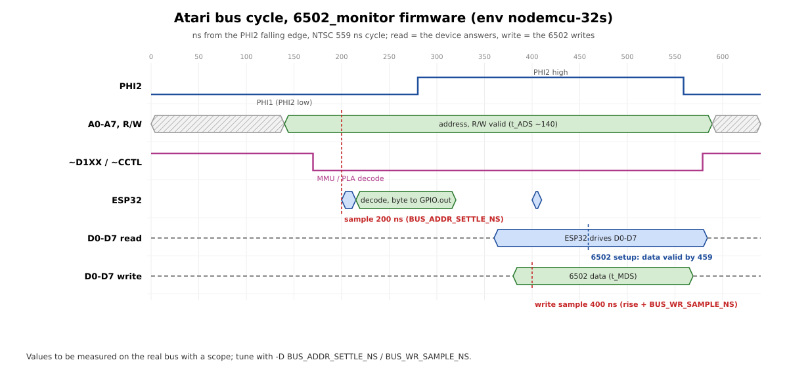

### Performance del Monitor

- **Campionamento**: un ciclo di bus per volta, Core 1 dedicato al 100%
- **Risposta in lettura**: byte (RAM del banco o registro) preparato durante PHI1, uscite accese subito dopo la salita di PHI2 (da misurare all'oscilloscopio)
- **Throughput seriale**: 115200 baud per debug (`LOG_BAUD`)
- **Compatibilità**: Atari PAL (1.77 MHz) e NTSC (1.79 MHz)

## 📁 File del Progetto

### Struttura Directory

```
ESP32-BOBOARD-5V/
├── 📁 firmware/
│   └── 📁 6502_monitor/
│       ├── 📄 platformio.ini          # Configurazione PlatformIO (ambienti nodemcu-32s / Atari e c64 / C64)
│       ├── 📄 efuse_vdd_sdio.py       # Controllo/programmazione efuse VDD_SDIO prima di ogni upload
│       ├── 📁 src/
│       │   └── 📄 main.cpp            # Firmware ESP32 (RAM a banchi PBI/CCTL + monitor)
│       ├── 📄 README.md, HARDWARE.md, PIN_MAPPING.md/.tex/.pdf, Logs.md
├── 📁 schematics/
│   └── 📄 ESP32-BOBOARD-5V.pdf    # Schema elettrico
├── 📁 3D/
│   ├── 🖼️ ESP32-BOBOARD-5V.png    # Render 3D
│   ├── 🖼️ ESP32-BOBOARD-5V_TOP.png
│   ├── 🖼️ ESP32-BOBOARD-5V_BOTTOM.png
│   └── 📄 ESP32-BOBOARD-5V.step   # Modello 3D
├── 📁 production/
│   ├── 📄 *.gbl, *.gtl           # File Gerber
│   ├── 📄 *.drl                  # File drill
│   └── 📄 ESP32BOBOARD-5V-1.0.zip
├── 📁 ibom/
│   └── 📄 ibom.html              # Interactive BOM
├── 📄 ESP32-BOBOARD-5V.kicad_pcb  # PCB KiCad
├── 📄 ESP32-BOBOARD-5V.sch        # Schema KiCad
├── 📄 ESP32-BOBOARD-5V.csv        # Bill of Materials
└── 📄 README.md                   # Questo file
```

### File di Produzione

#### Bill of Materials (BOM)

| Componente | Quantità | Package | LCSC Part |
|------------|----------|---------|-----------|
| **TXS0108EPW** | 3 | TSSOP-20 | C17206 |
| **100µF Capacitor** | 9 | 0805 | C141660 |
| **100nF Capacitor** | 1 | 0805 | C840116 |
| **10kΩ Resistor** | 4 | 0805 | C84376 |
| **5.1kΩ Resistor** | 2 | 0805 | C27834 |
| **1% Precision Resistor** | 2 | 0805 | C328378 |
| **Pin Socket 1x15** | 2 | THT | - |
| **Pin Header 2x16** | 1 | SMD | C6332241 |
| **USB-C Connector** | 1 | SMD | C3197885 |
| **SPST Switch** | 1 | SMD | C319052 |

#### File Gerber
- **4-layer PCB** ottimizzato per segnali ad alta velocità
- **Impedenza controllata** per linee critiche
- **Ground planes** per riduzione EMI
- **Via stitching** per integrità del segnale

## 🏭 Produzione

### Specifiche PCB

| Parametro | Valore |
|-----------|--------|
| **Layers** | 4 |
| **Thickness** | 1.6mm |
| **Min Track** | 0.1mm |
| **Min Via** | 0.2mm |
| **Copper Weight** | 1oz (35μm) |
| **Surface Finish** | HASL Lead-Free |
| **Solder Mask** | Green |
| **Silkscreen** | White |

### Assembly

1. **SMD Components**: Assemblaggio automatico raccomandato
2. **THT Components**: Saldatura manuale pin headers
3. **Test**: Verifica continuità e test funzionale
4. **Programming**: Upload firmware di test

## 📜 Licenza

Questo progetto è rilasciato sotto **GNU General Public License v3.0**.

```
ESP32-BOBOARD-5V - ESP32 NodeMCU 5V Tolerant Breakout Board
Copyright (C) 2024 RetroBitLab

This program is free software: you can redistribute it and/or modify
it under the terms of the GNU General Public License as published by
the Free Software Foundation, either version 3 of the License, or
(at your option) any later version.
```

Vedi il file [LICENSE](LICENSE) per i dettagli completi.

## 🤝 Contributi

I contributi sono benvenuti! Per contribuire:

1. **Fork** del repository
2. **Crea** un branch per la tua feature (`git checkout -b feature/AmazingFeature`)
3. **Commit** delle modifiche (`git commit -m 'Add some AmazingFeature'`)
4. **Push** al branch (`git push origin feature/AmazingFeature`)
5. **Apri** una Pull Request

### Aree di Contributo

- 🐛 **Bug fixes** e miglioramenti firmware
- 📚 **Documentazione** e tutorial
- 🔧 **Hardware** ottimizzazioni e varianti
- 🧪 **Testing** e validazione
- 🎨 **Examples** e progetti dimostrativi

### Reporting Issues

Per segnalare problemi, utilizzare il sistema di [Issues](../../issues) includendo:
- Descrizione dettagliata del problema
- Versione hardware e firmware
- Log seriali se disponibili
- Passi per riprodurre il problema

---

## 📞 Contatti

- **Progetto**: ESP32-BOBOARD-5V
- **Autore**: RetroBitLab
Repository: [GitHub](https://github.com/gianlucarenzi/esp32-boboard-5v)
- **Documentazione**: [Wiki](../../wiki)

---

*Realizzato con ❤️ per la comunità retro-computing*