# ESP32-BOBOARD-5V

**ESP32 NodeMCU 5V Tolerant Breakout Board for 6502 Bus Monitoring**

## 🌐 Language / Lingua

[](README.md)
[](README_EN.md)

---

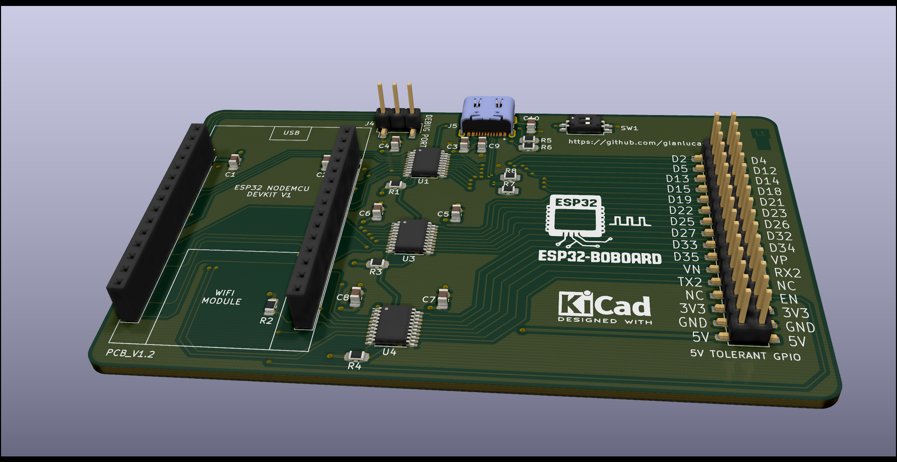

## 📋 Table of Contents

- [Project Overview](#project-overview)
- [Key Features](#key-features)
- [Technical Specifications](#technical-specifications)
- [3D Visualization](#3d-visualization)
- [Hardware Architecture](#hardware-architecture)
- [Firmware](#firmware)
- [Installation and Setup](#installation-and-setup)
- [Usage](#usage)
- [Flow Diagrams](#flow-diagrams)
- [Timing](#timing)
- [Project Files](#project-files)
- [Production](#production)
- [License](#license)
- [Contributing](#contributing)

## 🎯 Project Overview

ESP32-BOBOARD-5V is a specialized breakout board designed to interface an ESP32 NodeMCU module with 6502-based systems, such as the Atari 8-bit computers. The board provides:

- **5V tolerance** for all GPIO pins
- **Real-time 6502 bus monitoring**
- **PBI (Parallel Bus Interface) implementation** for Atari
- **Bidirectional level shifting** for 3.3V/5V compatibility
- **Standard connectors** for easy integration

### 🎮 Main Applications

- Monitoring and debugging 6502 systems
- PBI peripheral implementation for Atari
- Data/address bus traffic analysis
- Banked RAM expansions in the I/O area ($D1xx / $D5xx), GeoRAM style
- 256 KB GeoRAM for the Commodore 64 expansion port (`c64` env)
- Smart cartridge development

## ✨ Key Features

### Hardware
- **ESP32 NodeMCU** compatible (240MHz dual-core)
- **3x TXS0108E** bidirectional level shifters
- **5V tolerance** on all GPIO pins
- **USB-C connector** for programming and power
- **Standard PBI connector** for Atari
- **Pin headers** for complete GPIO access
- **Status LEDs** and control buttons

### Firmware
- **ROM-less PBI / CCTL banked RAM, GeoRAM style**: two pages, $D100–$D1FF (`~D1XX`) and $D500–$D5FF (`~CCTL`), decoded by the Atari MMU/PLA; only A0–A7 sampled
- **One latch at a time**: `$80` to $D1FF puts the registers in $D1xx and the RAM in $D500–$D5FF (256 bytes); `$80` to $D5FF puts the registers in $D5xx and the RAM in $D100–$D1FE (255 bytes: $D1FF, the PBI register, is protected unless built with `D1FF_RAM=1`); when deselected it never drives the bus
- **Register page**: bank count at $xxFB–$xxFC (read-only), 16-bit bank register at $xxFD–$xxFE, latch at $xxFF (bit 7, device ID `$80`)
- **Banks from the heap**: at boot the firmware takes the free ESP32 DRAM in 256-byte banks, one RAM for both modes (estimated 200–230 KB, the exact value is printed at boot)
- **Commodore 64 (`c64` env)**: the same board on the expansion port as a GeoRAM-compatible expansion: RAM window in IO1 $DE00–$DEFF, page in $DFFE and 16 KB block in $DFFF (write-only); /IO1 on J3 pin 12, /IO2 on J3 pin 11; 256 KB (16 blocks, aliased like a real GeoRAM: ~210 KB from DRAM, the rest from the ESP32 IRAM)
- **No ROM, no MPD / EXTSEL**: every bus pin is an input, D0–D7 become outputs only to answer a read
- **Dual-core**: Core 1 owns the bus (interrupts masked, decode during PHI1), Core 0 prints the log
- **Lock-free log** (Core 1 → Core 0): every access to both pages and every latch change, with microsecond timestamps

## 🔧 Technical Specifications

| Parameter | Value |
|-----------|-------|
| **Microcontroller** | ESP32-WROOM-32 |
| **CPU Frequency** | 240 MHz (dual-core) |
| **Flash Memory** | 4MB |
| **RAM** | 520KB |
| **Available GPIO** | 30 pins |
| **Level Shifters** | 3x TXS0108E (8-bit bidirectional) |
| **Power Supply** | 5V via USB-C or pins |
| **I/O Logic** | 3.3V/5V tolerant |
| **PCB Dimensions** | 21.7mm x 21.7mm |
| **Layers** | 4 layer PCB |

### 6502 Bus Pinout

| Signal | ESP32 Pin | Description |
|---------|-----------|-------------|
| **D0-D7** | GPIO4, GPIO5, GPIO13, GPIO14, GPIO16, GPIO17, GPIO18, GPIO19 | Data Bus (Bidirectional) |
| **A0-A3** | GPIO34, GPIO35, GPIO36, GPIO39 | Address Bus LSB (Input Only) |
| **A4-A7** | GPIO32, GPIO33, GPIO21, GPIO27 | Address Bus |
| **PHI2** | GPIO2 | 6502 Clock (1.79 MHz) |
| **R/W** | GPIO15 | Read/Write |
| **~D1XX** | GPIO22 | $D100–$D1FF page, from the MMU/PLA (Active Low, Input) |
| **~CCTL** | GPIO23 | $D500–$D5FF page, from the MMU/PLA (Active Low, Input) |
| **TX debug** | GPIO1 | Serial console 115200 bps (also on J4 pin 3) |

Not used by the firmware: GPIO12 (still wired to U1 / J3 pin 4, strapping pin), GPIO25 and GPIO26 (free TXS0108E channels), GPIO0 and GPIO3 (not routed to J3).

## 🎨 3D Visualization

### 📱 Interactive Online Viewers

View 3D models directly in your browser:

[](https://viewer.cadexchanger.com/)

[](https://3dviewer.net/?file=https://raw.githubusercontent.com/gianlucarenzi/esp32-boboard-5v/main/3D/ESP32-BOBOARD-5V.step)

[](https://viewer.autodesk.com/)


### 📥 Download 3D Files

| Format | Description | Download |
|---------|-------------|----------|
| **STEP** | Parametric CAD model | [](3D/ESP32-BOBOARD-5V.step) |
| **WRL** | VRML model for rendering | [](3D/ESP32-BOBOARD-5V.wrl) |

### 🖼️ 3D Image Gallery

<table>
  <tr>
    <td align="center">
      
      <br/><b>Isometric View</b>
    </td>
    <td align="center">
      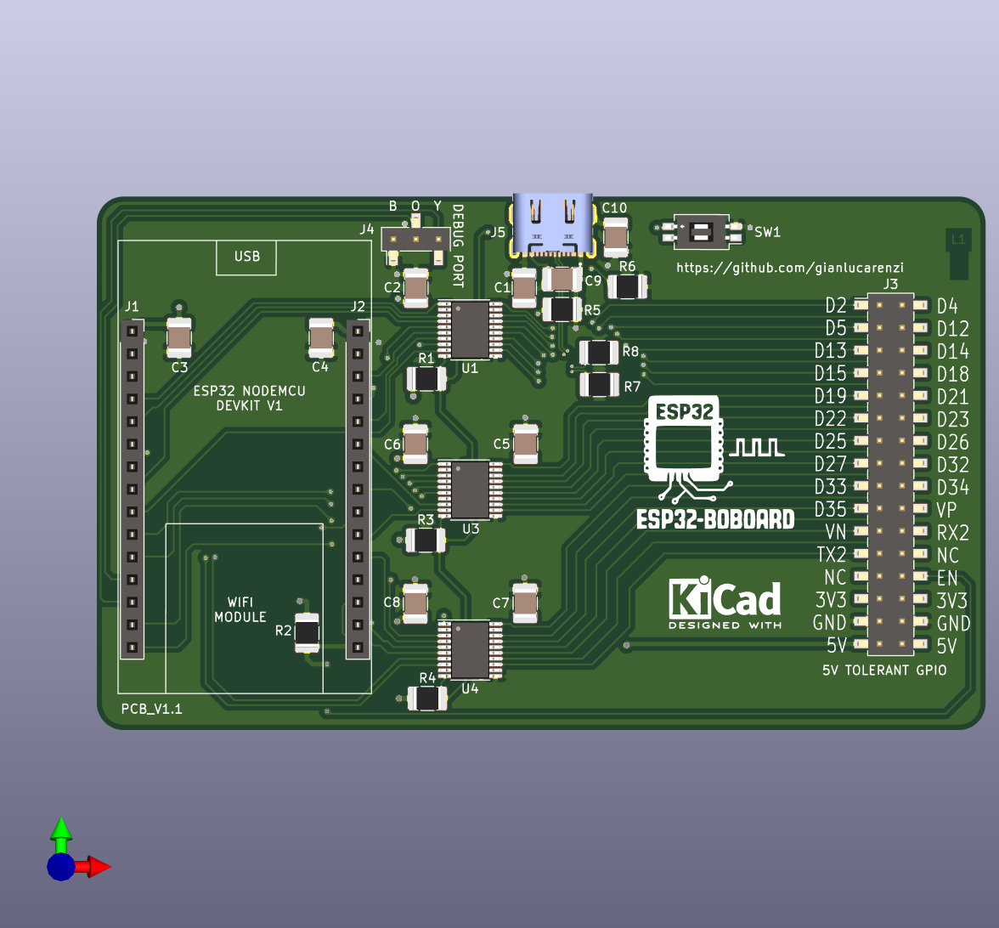
      <br/><b>Top View</b>
    </td>
  </tr>
  <tr>
    <td align="center">
      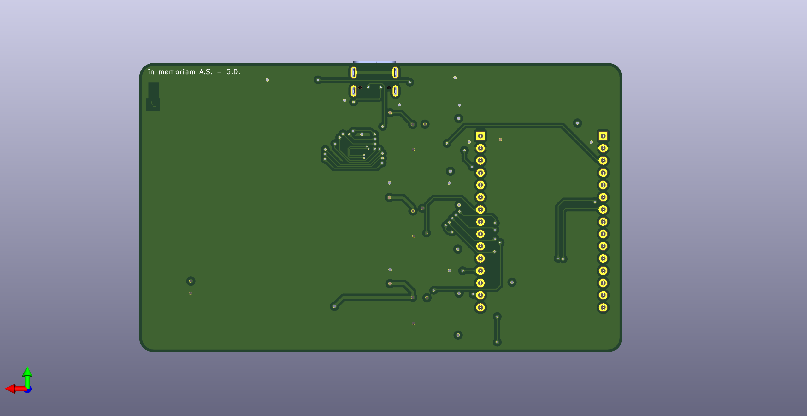
      <br/><b>Bottom View</b>
    </td>
    <td align="center">
      
      <br/><b><a href="schematics/ESP32-BOBOARD-5V.pdf">📄 Electrical Schematic</a></b>
    </td>
  </tr>
</table>

### 🛠️ Recommended Software for Visualization

| Software | Format | Platform | Free |
|----------|---------|-------------|----------|
| **FreeCAD** | STEP, WRL | Windows, Linux, macOS | ✅ |
| **Fusion 360** | STEP | Windows, macOS | ✅ (Personal) |
| **Blender** | WRL | Windows, Linux, macOS | ✅ |
| **MeshLab** | WRL | Windows, Linux, macOS | ✅ |
| **CAD Exchanger Viewer** | STEP, WRL | Browser | ✅ |
| **3D Viewer Online** | STEP, WRL | Browser | ✅ |
| **Autodesk Viewer** | STEP | Browser | ✅ |

---

## 🏗️ Hardware Architecture

### Block Diagram

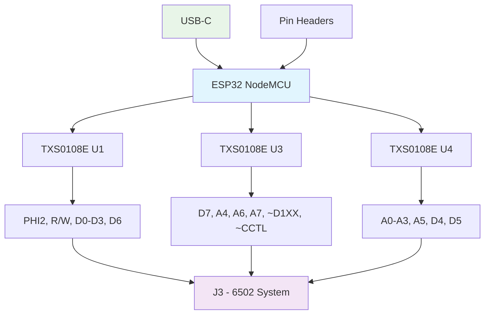

### Level Shifting

The board uses three TXS0108E to ensure compatibility between ESP32's 3.3V logic levels and the 6502 system's 5V.  The channels follow the module pins, not the functions:

- **U1**: PHI2 (GPIO2), D0 (GPIO4), D1 (GPIO5), GPIO12 (unused), D2 (GPIO13), D3 (GPIO14), R/W (GPIO15), D6 (GPIO18)
- **U3**: D7 (GPIO19), A6 (GPIO21), ~D1XX (GPIO22), ~CCTL (GPIO23), GPIO25 and GPIO26 (free), A7 (GPIO27), A4 (GPIO32)
- **U4**: A5 (GPIO33), A0 (GPIO34), A1 (GPIO35), A2 (GPIO36), A3 (GPIO39), D4 (GPIO16), D5 (GPIO17); channel 8 free

`TXS_EN` (OE of all three) is held high by R1/R3/R4; SW1 pulls it to GND to isolate the ESP32 from the bus.

## 💻 Firmware

### Software Architecture

The firmware is based on FreeRTOS and uses both ESP32 cores:

- **Core 0**: `LogTask`, the only writer on Serial
- **Core 1**: IRAM-resident `MonitorTask`, with interrupts masked and the interrupt watchdog disabled, owns the 6502 bus

### Main Features

#### 1. Bus cycle

- **PHI1**: 200 ns after PHI2 falls (`BUS_ADDR_SETTLE_NS`) it samples A0–A7, R/W, `~D1XX` and `~CCTL`; for a read of the RAM page or of a register of the register page it writes the byte to `GPIO.out` with the outputs still off
- **PHI2 rising edge**: one store turns D0–D7 on; if the select shows up only on the rising edge, the byte is driven late
- **Write**: data sampled 120 ns after PHI2 rises (`BUS_WR_SAMPLE_NS`)
- **PHI2 falling edge**: D0–D7 released; the cycle's event goes to the log during the next PHI1

#### 2. PBI / CCTL Banked RAM (GeoRAM Style)

One page holds the registers, the other one is a 256-byte window on the RAM, like the C64 GeoRAM between IO1 and IO2.  One latch at a time:

| Latch written | Registers | RAM window |
|---------------|-----------|------------|
| $D1FF ← `$80` | $D1xx | $D500–$D5FF (256 bytes) |
| $D5FF ← `$80` | $D5xx | $D100–$D1FE (255 bytes; $D1FF protected) |

Deselected, $D1FF and $D5FF are both latches and nothing else is decoded.  In the RAM page the latch is RAM: to move the registers to the other page, deselect first.

Register page:

| Offset | Function | Notes |
|--------|----------|-------|
| **$00–$FA** | Reserved | Never driven, writes ignored |
| **$FB–$FC** | Number of banks (R, 16 bit) | Depends on the free heap, writes ignored |
| **$FD–$FE** | Bank register (R/W, 16 bit, little-endian) | A bank beyond the count does not respond |
| **$FF** | Latch (W: bit 7 = 0 deselects) | Never driven on reads |

$D1FF is the PBI register of the Atari (the OS reads it on every IRQ, other PBI devices drive it): with the RAM in $D1xx it stays protected, never driven and writes ignored.  With `-D D1FF_RAM=1` it becomes RAM too, only without other PBI devices.

Wiring to the Atari 130XE (cartridge slot and ECI).  On the 800XL the PBI connector carries no `~D1XX`: $D1xx has to be decoded from A8–A15 with external logic, not provided on this board:

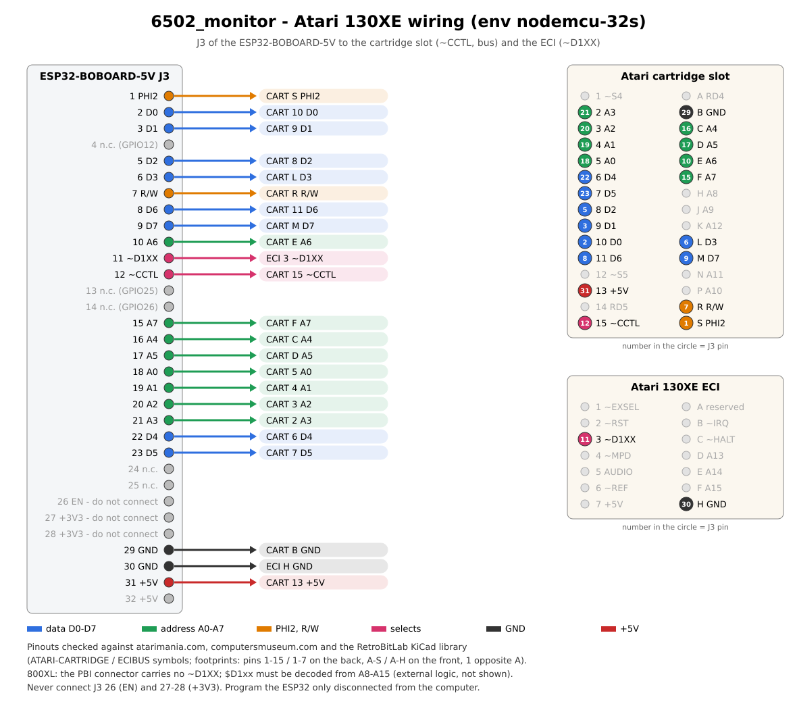

Breadboard view, Fritzing style:

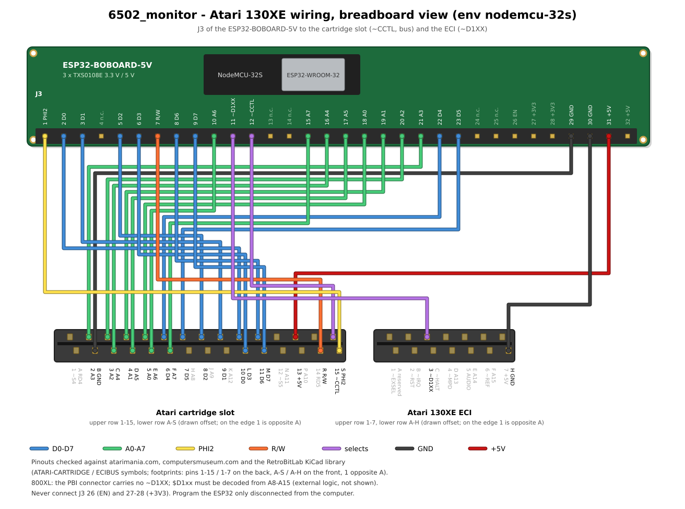

The 256-byte banks are allocated at boot from the free ESP32 DRAM heap (minus 24 KB kept for the system); one RAM and one bank register for both modes.  Linear address: bank = address >> 8, offset = address & $FF.  Power-up: deselected, bank 0, RAM `$00`; the device does not see the Atari RESET and keeps its state, the RAM is not kept across an ESP32 reset.  Without a ROM the OS PBI scan finds no signature at $D803 / $D80B and skips the device: programs select it directly by writing `$80` to $D1FF / $D5FF.

#### 3. Commodore 64: 256 KB GeoRAM (`c64` env)

The same board, built with the `c64` env (`-D BUS_C64=1`), becomes a GeoRAM-compatible expansion for the C64 expansion port, with the same scheme as the Vera-Module-RBL-C64 firmware:

| Address | Function | Notes |
|---------|----------|-------|
| **$DE00–$DEFF** (/IO1) | 256-byte window on the RAM | Read and write |
| **$DFFE** (/IO2) | Page within the block (0–63) | Write-only, not driven on reads |
| **$DFFF** (/IO2) | 16 KB block (0–15) | Write-only, not driven on reads |

- **Always enabled**, no latch, like the original cartridge; the rest of IO2 is not decoded (no mirrors in $DF80–$DFFD)
- **256 KB, 16 blocks**: address = block × 16384 + page × 256 + offset; the block is masked to the size (block 16 aliases block 0) as on a real GeoRAM, so size detection sees a 256 KB unit.  `-D GEORAM_KB=...` for another power of two
- **Memory**: about 210 KB from the ESP32 DRAM and the rest from the free IRAM, read and written with 32-bit accesses only; if it is not enough the firmware drops to 128 KB and says so in the banner.  The original geoRAM was 512 KB: software that requires that size will not work
- **Bus cycle**: the VIC-II owns the bus during PHI1, so everything happens with PHI2 high: after the rise the firmware waits at most 200 ns for /IO1 or /IO2 (`IO_QUALIFY_NS`), samples A0–A7 and, on a read, drives the byte at once until PHI2 falls; write data is sampled 300 ns after the rise (`BUS_WR_SAMPLE_NS`)
- **State**: zeroed at power-up, kept across a C64 reset; the RAM is not kept across an ESP32 reset

Wiring to the expansion port (C64 pinout checked against c64-wiki.com and retroisle.com):

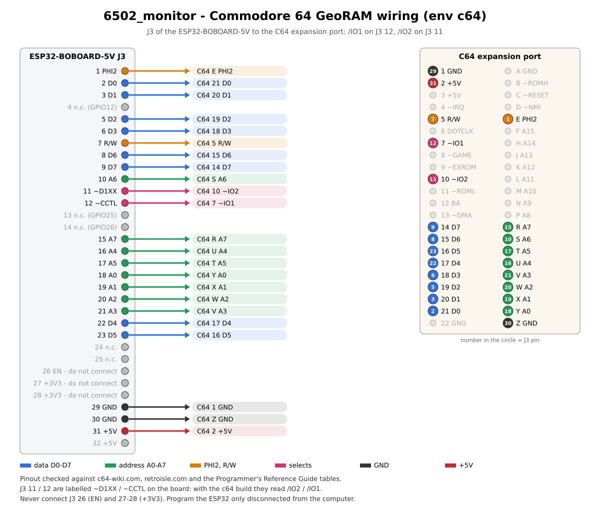

Breadboard view, Fritzing style:

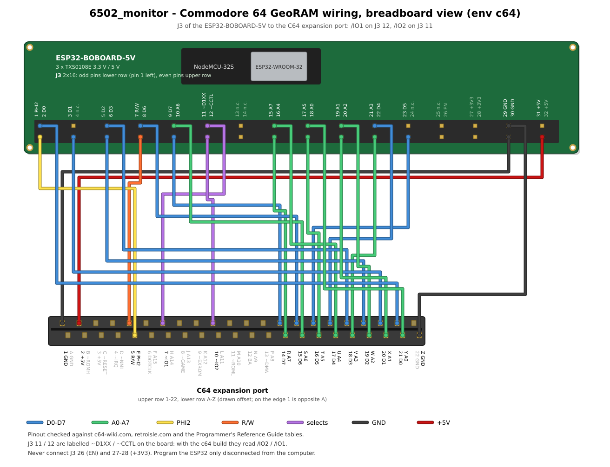


| Signal | C64 port | J3 |
|--------|----------|----|
| **/IO1** | 7 | 12 (GPIO23, `~CCTL` input) |
| **/IO2** | 10 | 11 (GPIO22, `~D1XX` input) |
| D0 / D1 / D2 / D3 | 21 / 20 / 19 / 18 | 2 / 3 / 5 / 6 |
| D4 / D5 / D6 / D7 | 17 / 16 / 15 / 14 | 22 / 23 / 8 / 9 |
| A0 / A1 / A2 / A3 | Y / X / W / V | 18 / 19 / 20 / 21 |
| A4 / A5 / A6 / A7 | U / T / S / R | 16 / 17 / 10 / 15 |
| Φ2 | E | 1 |
| R/W | 5 | 7 |
| GND | 1, 22, A, Z | 29, 30 |
| +5V | 2, 3 | 31, 32 |

Serial output (page counts and free memory depend on the board):

```
[6502_monitor] GeoRAM on the C64 expansion port: 256 KB = 16 blocks x 16 KB
[6502_monitor] Pages: <d> in DRAM, <i> in IRAM, <b> heap blocks; left <h> bytes DRAM, <r> bytes IRAM
[6502_monitor] IO1 $DE00-$DEFF RAM, IO2 $DFFE page, $DFFF block (write-only)
[6502_monitor] /IO1 on J3 pin 12 (GPIO23), /IO2 on J3 pin 11 (GPIO22)
[6502_monitor] Bus loop on Core 1 (/IOx within 200 ns, write sample 300 ns after PHI2 rises), log 115200 baud
[    2.000000] [DFFF - GEORAM_BLOCK        ] W $04  SEL
[    2.000010] [DFFE - GEORAM_PAGE         ] W $23  SEL
[    2.000020] [DE45 - RAM blk $04 pg $23 +$45] R $12  SEL DRV
```

Use from the C64:
```
LDA #$04 : STA $DFFF   ; block 4
LDA #$23 : STA $DFFE   ; page 35
LDA $DE45              ; GeoRAM byte $12345
```

To be verified on the hardware: the banner (actual 256 KB), the timing with a scope and the compatibility with GEOS and GeoRAM software.

## 🚀 Installation and Setup

### Hardware Requirements
- ESP32 NodeMCU DevKit V1 (30 pins, ESP32-WROOM-32)
- USB-C cable for programming
- Target 6502 system (e.g. Atari 130XE)
- Bus connections according to pinout

### Software Requirements
- [PlatformIO](https://platformio.org/) or Arduino IDE
- ESP32 Arduino Core v2.0.14
- USB-C drivers for operating system

### Firmware Compilation

1. **Repository clone**:
```bash
git clone https://github.com/gianlucarenzi/esp32-boboard-5v.git
cd ESP32-BOBOARD-5V/firmware/6502_monitor
```

2. **PlatformIO configuration** (excerpt of `platformio.ini`):
```ini
[env]
extra_scripts = post:efuse_vdd_sdio.py
monitor_rts = 0
monitor_dtr = 0
custom_efuse_vdd_sdio = 3.3V

[env:nodemcu-32s]
platform = espressif32@6.6.0
board = nodemcu-32s
framework = arduino
monitor_speed = 115200
upload_speed = 921600
board_build.f_cpu = 240000000

[env:c64]                      ; Commodore 64, GeoRAM
extends = env:nodemcu-32s
build_flags = ${env:nodemcu-32s.build_flags} -D BUS_C64=1
```

The module is **always programmed disconnected from the Atari or the C64**, connected only to the PC.  Before every upload `efuse_vdd_sdio.py` checks the VDD_SDIO efuses and, if they are blank, burns them to 3.3 V (**irreversible**), so GPIO12 is no longer sampled at reset.

3. **Compilation and upload**:
```bash
pio run -e nodemcu-32s --target upload   # Atari
pio run -e c64 --target upload           # Commodore 64 (GeoRAM)
pio device monitor
```

### Hardware Configuration

1. **ESP32 connection**: Insert NodeMCU module into sockets
2. **Power**: Connect USB-C or 5V power supply
3. **6502 Bus**: Connect according to specified pinout
4. **Test**: Run test mode to verify connections

## 📊 Usage

### System Startup

1. **Power-on**: Power up the board
2. **Serial monitor**: Open terminal at 115200 baud
3. **Initialization**: Wait for ready message
4. **6502 connection**: Connect to target system

### Serial Output

Core 0 prints every event that Core 1 records in a lock-free ring buffer.
Timestamp format is `[seconds.microseconds]`:

```
[6502_monitor] Banked RAM PBI / CCTL peripheral, device ID $80
[6502_monitor] <n> banks x 256 bytes = <k> KB, <b> heap blocks, <h> bytes of heap left
[6502_monitor] $D1FF <- $80: RAM $D500-$D5FF; $D5FF <- $80: RAM $D100-$D1FE ($D1FF protected)
[6502_monitor] Register page: count $xxFB-$xxFC, bank $xxFD-$xxFE, latch $xxFF
[6502_monitor] Bus loop on Core 1 (settle 200 ns, write sample 120 ns), log 115200 baud
[    1.234567] [D1FF - PBI_SELECT          ] W $80  SELECTED: registers $D1xx, RAM $D5xx
[    1.234601] [D1FD - BANK_SELECT_L       ] W $03  SEL
[    1.234620] [D1FE - BANK_SELECT_H       ] W $01  SEL
[    1.234640] [D505 - RAM bank $0103 +$05 ] W $AA  SEL
[    1.234680] [D505 - RAM bank $0103 +$05 ] R $AA  SEL DRV
[    1.300000] [D105 - RESERVED            ] R $FF  SEL
```
```

- `PBI_SELECT` / `CCTL_SELECT` — latch write and new state: `SELECTED` / `DESELECTED`
- `SEL` = device selected, `DRV` = byte driven by the device, `-` = not selected (the byte is whatever was on the bus)
- Offsets are shown as `RAM bank $bbbb +$oo`, `BANK_COUNT_L/H`, `BANK_SELECT_L/H`, `PBI_SELECT` / `CCTL_SELECT` or `RESERVED`; the bank numbers in the example are indicative
- Timestamps come from the Core 1 cycle counter (CCOUNT extended to 64 bit)
- Each line is a single `Serial.write()`: lines never interleave; events lost when the ring is full are counted
- Read-only debug also on J4: GND (pin 1) and TX0 (pin 3, 3.3 V); leave RX0 (pin 2) unconnected

## 📈 Flow Diagrams

### Main Monitor Flow

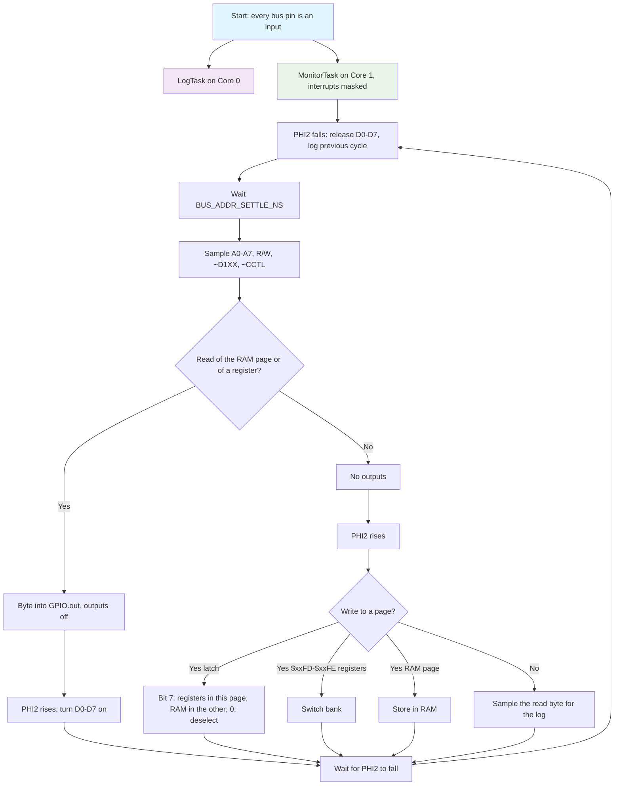

### Select Protocol (PBI)

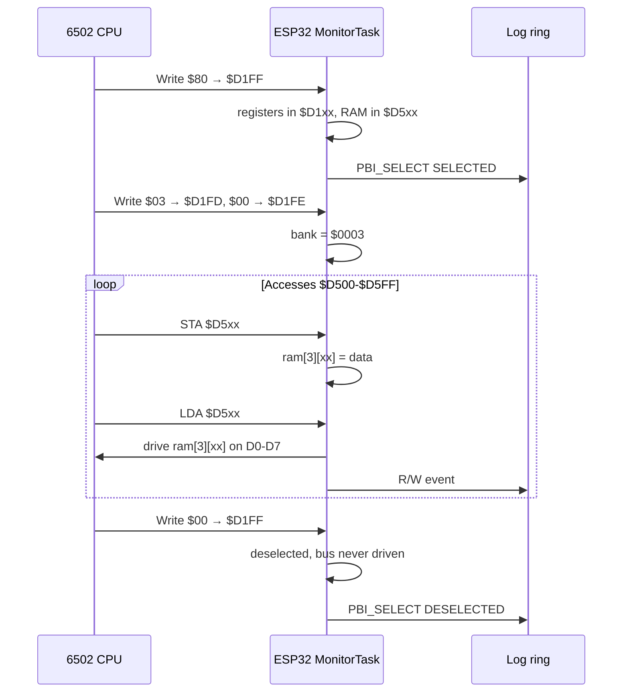

## ⏱️ Timing

### Critical Timings

| Operation | Time | Notes |
|------------|-------|------|
| **PHI2 Period** | 1.77 MHz (PAL) / 1.79 MHz (NTSC) | Atari 6502 clock |
| **Address Setup** | <100ns | Before PHI2 rising edge |
| **Data Setup** | <200ns | For write operations |
| **Data Hold** | <100ns | After PHI2 falling edge |
| **GPIO Read** | ~125ns | ESP32 register read |
| **Level Shift** | <10ns | TXS0108E propagation |

### 6502 Bus Timing Diagram

```mermaid
gantt
    title Atari bus cycle, nodemcu-32s firmware (ns, NTSC 559 ns)
    dateFormat x
    axisFormat %L
    tickInterval 50millisecond

    section PHI2
    Low (PHI1)                      :p1, 0, 280
    High (PHI2)                     :active, p2, 280, 559

    section 6502 / MMU
    A0-A7, R/W valid (t_ADS)        :a1, 140, 559
    ~D1XX / ~CCTL valid             :a2, 170, 559

    section ESP32
    Sample address and selects      :crit, e1, 200, 215
    Decode, byte into GPIO.out      :e2, 215, 320
    Read - D0-D7 driven             :active, e3, 360, 559
    Write - data sampled            :crit, e4, 400, 410

    section 6502 reads
    Data stable (t_DSU 100 ns)      :d1, 459, 559
```

### Monitor Performance

- **Sampling**: one bus cycle at a time, Core 1 fully dedicated
- **Read response**: byte (bank RAM or register) prepared during PHI1, outputs on right after PHI2 rises (to be measured with a scope)
- **Serial throughput**: 115200 baud for debug (`LOG_BAUD`)
- **Compatibility**: Atari PAL (1.77 MHz) and NTSC (1.79 MHz)

## 📁 Project Files

### Directory Structure

```
ESP32-BOBOARD-5V/
├── 📁 firmware/
│   └── 📁 6502_monitor/
│       ├── 📄 platformio.ini          # PlatformIO configuration (envs nodemcu-32s / Atari and c64 / C64)
│       ├── 📄 efuse_vdd_sdio.py       # VDD_SDIO efuse check/burn before every upload
│       ├── 📁 src/
│       │   └── 📄 main.cpp            # ESP32 firmware (PBI/CCTL banked RAM + monitor)
│       ├── 📄 README.md, HARDWARE.md, PIN_MAPPING.md/.tex/.pdf, Logs.md
├── 📁 schematics/
│   └── 📄 ESP32-BOBOARD-5V.pdf    # Electrical schematic
├── 📁 3D/
│   ├── 🖼️ ESP32-BOBOARD-5V.png    # 3D render
│   ├── 🖼️ ESP32-BOBOARD-5V_TOP.png
│   ├── 🖼️ ESP32-BOBOARD-5V_BOTTOM.png
│   └── 📄 ESP32-BOBOARD-5V.step   # 3D model
├── 📁 production/
│   ├── 📄 *.gbl, *.gtl           # Gerber files
│   ├── 📄 *.drl                  # Drill files
│   └── 📄 ESP32BOBOARD-5V-1.0.zip
├── 📁 ibom/
│   └── 📄 ibom.html              # Interactive BOM
├── 📄 ESP32-BOBOARD-5V.kicad_pcb  # KiCad PCB
├── 📄 ESP32-BOBOARD-5V.sch        # KiCad schematic
├── 📄 ESP32-BOBOARD-5V.csv        # Bill of Materials
└── 📄 README.md                   # This file
```

### Production Files

#### Bill of Materials (BOM)

| Component | Quantity | Package | LCSC Part |
|------------|----------|---------|-----------|
| **TXS0108EPW** | 3 | TSSOP-20 | C17206 |
| **100µF Capacitor** | 9 | 0805 | C141660 |
| **100nF Capacitor** | 1 | 0805 | C840116 |
| **10kΩ Resistor** | 4 | 0805 | C84376 |
| **5.1kΩ Resistor** | 2 | 0805 | C27834 |
| **1% Precision Resistor** | 2 | 0805 | C328378 |
| **Pin Socket 1x15** | 2 | THT | - |
| **Pin Header 2x16** | 1 | SMD | C6332241 |
| **USB-C Connector** | 1 | SMD | C3197885 |
| **SPST Switch** | 1 | SMD | C319052 |

#### Gerber Files
- **4-layer PCB** optimized for high-speed signals
- **Controlled impedance** for critical lines
- **Ground planes** for EMI reduction
- **Via stitching** for signal integrity

## 🏭 Production

### PCB Specifications

| Parameter | Value |
|-----------|--------|
| **Layers** | 4 |
| **Thickness** | 1.6mm |
| **Min Track** | 0.1mm |
| **Min Via** | 0.2mm |
| **Copper Weight** | 1oz (35μm) |
| **Surface Finish** | HASL Lead-Free |
| **Solder Mask** | Green |
| **Silkscreen** | White |

### Assembly

1. **SMD Components**: Automatic assembly recommended
2. **THT Components**: Manual soldering of pin headers
3. **Test**: Continuity check and functional test
4. **Programming**: Upload test firmware

## 📜 License

This project is released under **GNU General Public License v3.0**.

```
ESP32-BOBOARD-5V - ESP32 NodeMCU 5V Tolerant Breakout Board
Copyright (C) 2024 RetroBitLab

This program is free software: you can redistribute it and/or modify
it under the terms of the GNU General Public License as published by
the Free Software Foundation, either version 3 of the License, or
(at your option) any later version.
```

See the [LICENSE](LICENSE) file for complete details.

## 🤝 Contributing

Contributions are welcome! To contribute:

1. **Fork** the repository
2. **Create** a feature branch (`git checkout -b feature/AmazingFeature`)
3. **Commit** your changes (`git commit -m 'Add some AmazingFeature'`)
4. **Push** to the branch (`git push origin feature/AmazingFeature`)
5. **Open** a Pull Request

### Contribution Areas

- 🐛 **Bug fixes** and firmware improvements
- 📚 **Documentation** and tutorials
- 🔧 **Hardware** optimizations and variants
- 🧪 **Testing** and validation
- 🎨 **Examples** and demo projects

### Reporting Issues

To report problems, use the [Issues](../../issues) system including:
- Detailed problem description
- Hardware and firmware version
- Serial logs if available
- Steps to reproduce the issue

---

## 📞 Contacts

- **Project**: ESP32-BOBOARD-5V
- **Author**: RetroBitLab
Repository: [GitHub](https://github.com/gianlucarenzi/esp32-boboard-5v)
- **Documentation**: [Wiki](../../wiki)

---

*Made with ❤️ for the retro-computing community*