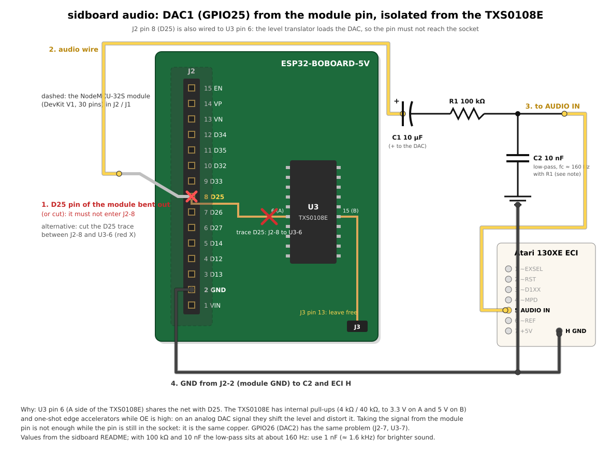
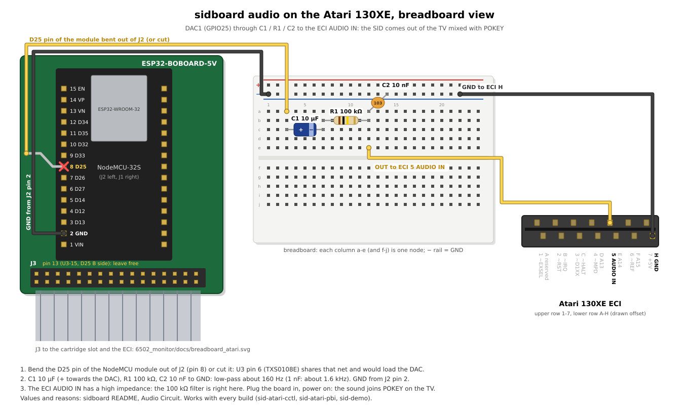
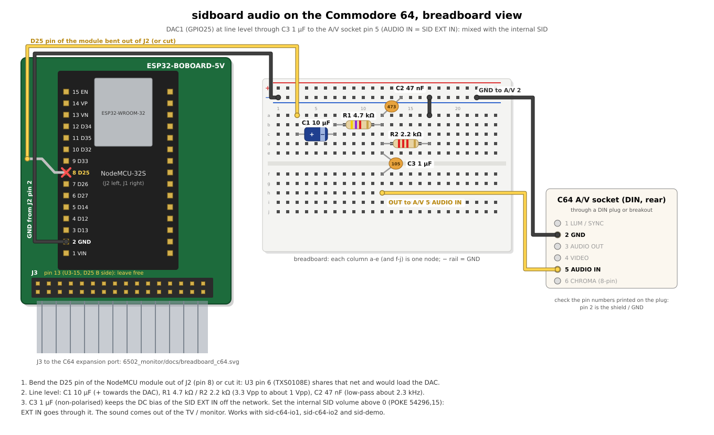

# Sidboard — SID Sound for the Atari 8-bit (ESP32-BOBOARD-5V)

Firmware for the **ESP32-BOBOARD-5V** (NodeMCU-32S) on the Atari 8-bit bus:

- **SID 6581/8580 sound** (cSIDLight: 3 square-wave voices, frequency, gate,
  master volume; ESP32 DAC1 on GPIO 25, 22.2 kHz)
- two Atari builds: **CCTL** (`$D500`, always on) or **PBI device**
  (`$D100`, select latch `$D1FF`)
- two **Commodore 64** builds (second SID on the expansion port): block
  **`/IO1`** (`$DE00`) or **`/IO2`** (`$DF00`)
- the bus loop of the [6502_monitor](../6502_monitor/README.md) firmware:
  PHI1 decode in assembly on Core 1, interrupts masked, lock-free log
- timestamped serial log of every access to the SID page

---

## Builds

| Environment | SID registers | Select | Wiring |
|---|---|---|---|
| `sid-atari-cctl` | `$D500-$D51E` | always on, no latch, no configuration | Atari `~CCTL` → J3 pin 12 |
| `sid-atari-pbi` | `$D100-$D11E` | PBI device ID `$80`: write `$80` to `$D1FF` to select, `$00` to deselect | `~D1XX` → J3 pin 11 |
| `sid-c64-io1` | `$DE00-$DE1E` | C64, always on (`SID_C64_IO=1`) | C64 `/IO1` (port pin 7) → J3 pin 12 |
| `sid-c64-io2` | `$DF00-$DF1E` | C64, always on (`SID_C64_IO=2`) | C64 `/IO2` (port pin 10) → J3 pin 11 |
| `sid-demo` | none | built-in tune (`AUDIO_DEMO`), no bus loop | Atari or C64, or nothing |

**`sid-demo`:** the Commando tune (`examples/Commando_dmp.h`) loops at
50 Hz on DAC1 with no driver on the computer: the bus loop is not started,
every bus pin stays an input and nothing is ever driven, so the same build
works anywhere.  On the Atari, plugged in and powered on, the sound comes
out mixed with POKEY through the audio input (ECI AUDIO IN, see Audio
Circuit); on the C64 the expansion port has no audio input, so DAC1 must be
wired to an external amplifier or mixer to be heard (see [Amplifier](#amplifier-c64-or-listening-without-the-atari)).

Only A0-A7 are sampled: the page comes from the select line.  Offsets
`$1F-$FE` of the page are not decoded (never driven, writes ignored).
Reads of `$00-$1E` return the stored register byte.

**`sid-atari-pbi`:** `$D1FF` is never driven (it is the PBI interrupt status read
by the OS).  Deselected, the SID neither answers nor stores writes, but it
**keeps playing**: deselecting only removes it from the bus.  The OS PBI
scan at power-up and RESET writes `$80` then `$00` to `$D1FF`, so the SID
ends deselected with its registers unchanged.  There is no PBI ROM (the
board has no MPD / EXTSEL), so the OS does not install a handler: programs
access the registers directly.

**`sid-atari-cctl`:** `$D5xx` belongs to the SID: cartridges that bank-switch
through CCTL (XEGS, AtariMax, SpartaDOS X, ...) cannot be used with it; use
`sid-atari-pbi` then.

**C64 (`sid-c64-io1` / `sid-c64-io2`):** the block is chosen at build time
with `-D SID_C64_IO=1` or `2` (`SID_BUS_C64=1`); only that select line needs
to be wired, the other block is never touched.  The C64 has no
PBI-like select latch: the SID answers whenever its block is decoded, so
pick the block that no other cartridge uses.  `/IO2` (`$DF00`) clashes with
a REU (17xx, Ultimate, Kung Fu Flash ...) and the GeoRAM registers;
`/IO1` (`$DE00`) with EasyFlash, MIDI and SwiftLink / RR-Net interfaces:
`sid-c64-io1` is the default choice.  The rest of the C64 wiring (data,
A0-A7, PHI2, R/W, GND, +5V) is the one of the 6502_monitor `c64` build, see
[`wiring_c64.svg`](../6502_monitor/docs/wiring_c64.svg).  The expansion
port has no audio input: DAC1 goes to an external amplifier or mixer.

---

## Pin Mapping

Same pins as the 6502_monitor firmware (J3 of the ESP32-BOBOARD-5V, 5 V side
of the TXS0108E); full table in [PIN_MAPPING.md](PIN_MAPPING.md), wiring
infographics in [`../6502_monitor/docs/`](../6502_monitor/docs/wiring_atari.svg).

| Signal | GPIO | J3 pin |
|---|---|---|
| D0-D7 | 4, 5, 13, 14, 16, 17, 18, 19 | 2, 3, 5, 6, 22, 23, 8, 9 |
| A0-A7 | 34, 35, 36, 39, 32, 33, 21, 27 | 18, 19, 20, 21, 16, 17, 10, 15 |
| PHI2 / R/W | 2 / 15 | 1 / 7 |
| `~D1XX` (sid-atari-pbi) | 22 | 11 |
| `~CCTL` (sid-atari-cctl) | 23 | 12 |
| C64 `/IO2` (sid-c64-io2) | 22 | 11 |
| C64 `/IO1` (sid-c64-io1) | 23 | 12 |
| DAC1 audio | 25 | (module pin) |
| TX debug | 1 | J4 pin 3 |

> **Changed from the previous firmware:** CCTL was read on GPIO 22 with
> A0-A4 only; it is now on GPIO 23 (J3 pin 12) with A0-A7, as on the
> 6502_monitor firmware and the board netlist.

---

## SID Register Map

Base `$D500` (sid-atari-cctl), `$D100` (sid-atari-pbi), `$DE00` (sid-c64-io1) or
`$DF00` (sid-c64-io2).

| Offset | Register | Emulated |
|--------|----------|----------|
| `$00/$01` | V1 Freq Lo/Hi | yes |
| `$02/$03` | V1 PW Lo/Hi | no |
| `$04` | V1 CTRL | GATE (bit 0) |
| `$05/$06` | V1 AD/SR | no |
| `$07-$0D` | Voice 2 (as V1) | as V1 |
| `$0E-$14` | Voice 3 (as V1) | as V1 |
| `$15/$16` | FC Lo/Hi | no |
| `$17` | RES/FILT | no |
| `$18` | MODE/VOL | volume (bits 3-0) |
| `$19/$1A` | POTX / POTY | no (read back the stored byte) |
| `$1B/$1C` | OSC3 / ENV3 | no (read back the stored byte) |
| `$1D/$1E` | unused | stored |
| `$FF` | `PBI_SELECT` (sid-atari-pbi only) | latch, bit 7 |

---

## Architecture

```
Core 0                                    Core 1 (interrupts masked)
──────────────────────────────            ─────────────────────────────────────
LogTask   only writer on Serial            MonitorTask (IRAM, highest priority)
          drains the log ring               PHI2 falls: release D0-D7, log
SidTask   process() every 1 ms             + BUS_ADDR_SETTLE_NS (200 ns):
          registers -> synthesis              sample A0-A7, R/W, select
esp_timer 22.2 kHz _tick() -> DAC1            read of $00-$1E: byte to GPIO.out
                                            PHI2 rises: one store drives D0-D7
                                            write: sample + BUS_WR_SAMPLE_NS
                                              (120 ns) -> register / latch
```

- **Bus loop** (from the 6502_monitor firmware, itself from
  Vera-Module-RBL-XE): Core 1 runs only MonitorTask with interrupts masked
  and the interrupt watchdog off.  The PHI1 decode is inline assembly:
  address from two lookup tables, register byte placed in `GPIO.out` while
  the outputs are still off, turned on with one store at the PHI2 rising
  edge.  A select seen only on the rising edge is handled from that sample.
  GPIO accesses without `memw`.
- **Registers:** the bus loop stores straight into the cSIDLight register
  array (`regs()`); SidTask turns changes into synthesis parameters within
  1 ms.
- **Log:** lock-free single-producer / single-consumer ring (1024 events)
  from Core 1 to LogTask; one `Serial.write()` per line, events dropped and
  counted when the ring is full.

Serial output:

```
[sidboard] SID PBI device, ID $80: $D100-$D11E, select $D1FF (~D1XX, J3 pin 11)
[sidboard] cSIDLight: 3 voices, DAC1 on GPIO 25, 22222 Hz
[sidboard] Bus loop on Core 1 (settle 200 ns, write sample 120 ns), log 115200 baud
[    1.234567] [D1FF - PBI_SELECT  ] W $80  SELECTED
[    1.234601] [D100 - V1_FREQ_LO  ] W $3C  SEL
[    1.234620] [D104 - V1_CTRL     ] W $11  SEL
[    1.300000] [D104 - V1_CTRL     ] R $11  SEL DRV
```

`SEL` = the SID answers, `DRV` = byte driven by the board, `-` = deselected
(the logged byte is whatever was on the bus).

---

## cSIDLight Audio Engine

Defined in `include/csidlight.h`. Self-contained — no external audio library.

### Parameters

| Parameter | Value |
|-----------|-------|
| Target sample rate | 22050 Hz |
| Timer period | 45 µs (`SID_TIMER_US`, integer truncation of 45.351 µs) |
| Actual sample rate | 22222 Hz (`SID_ACTUAL_RATE = 1000000 / SID_TIMER_US`) |
| Output pin | GPIO 25 (ESP32 DAC1) |
| Voices | 3 independent square-wave oscillators |
| Emulated | Frequency, GATE, master volume |
| Not emulated | ADSR envelope, waveform selection, filter, ring-mod, sync |

### Frequency Formula (PAL clock = 985248 Hz)

`esp_timer` fires every 45 µs (integer microseconds), giving an actual sample rate of 22222 Hz rather than the nominal 22050 Hz. `_phaseIncFor()` uses `SID_ACTUAL_RATE` to match the real timer cadence and keep pitch accurate.

```
freq_hz  = (reg16 × 985248) / 2^24
phaseInc = (freq_hz × 2^32) / 22222     ← SID_ACTUAL_RATE, not 22050
```

At each tick the oscillator phase always advances, regardless of gate state (as on a real SID):

```
phase[i] += phaseInc[i]                 ← unconditional
if voiceVol[i] != 0:
    square = (phase[i] & 0x80000000) ? +voiceVol[i] : -voiceVol[i]
    mix   += square
mix = clamp(128 + mix, 0, 255)
dacWrite(25, mix)
```

### Master Volume

Volume nibble is multiplied before dividing to avoid integer truncation loss:

```
voiceVol = (reg[$18] & 0x0F) × 128 / 48   // max 40 per voice; 3 × 40 = 120 ≤ 128
```

### API Surface

| Method | Caller | Description |
|--------|--------|-------------|
| `write(reg, val)` | AUDIO_DEMO timer | Single `volatile` byte store — no locking (the bus loop stores into `regs()` directly) |
| `process()` | SidTask (Core 0, every 1 ms) | Snapshot diff → update synthesis params |
| `regs()` | `setup()` | Register array, read and written directly by the bus loop |
| `reset()` | not used | Zero all registers, silence voices |
| `_tick()` | `esp_timer` (Core 0) | Generate one audio sample, write DAC |

---

## Audio Circuit

GPIO 25 is the ESP32 DAC1 output (0–3.3 V, 8 bit, 22.2 kHz).

**On the ESP32-BOBOARD-5V the DAC pin is not free:** in the netlist `/D25`
joins J2 pin 8 (the module socket) and U3 pin 6, the A side of a TXS0108E
channel whose B side goes to J3 pin 13.  While OE is high the TXS0108E keeps
internal pull-ups on both sides (4 kΩ / 40 kΩ, to 3.3 V and 5 V) and
one-shot edge accelerators: on an analog signal they shift the level and
distort it.  Taking the signal from the module pin does not help while that
pin is still in the socket (same copper), so:

1. bend the D25 pin of the module out of the socket (or cut it), or cut the
   trace between J2 pin 8 and U3 pin 6;
2. wire the module pin to the filter, C1 positive side towards the DAC;
3. filter output to the Atari 130XE ECI pin 5 (AUDIO IN);
4. ground from J2 pin 2 (module GND) to C2 and ECI pin H.

Leave J3 pin 13 unconnected.  GPIO 26 (DAC2) has the same problem (J2 pin 7,
U3 pin 7).



Drawing generated by [`docs/audio_wiring.py`](docs/audio_wiring.py).  With
R1 = 100 kΩ and C2 = 10 nF the low-pass corner is about 160 Hz (the earlier
figure of 1.75 kHz was wrong): C2 = 1 nF gives about 1.6 kHz, closer to the
range of the square-wave voices.

Breadboard view of the same circuit on the Atari 130XE (ECI AUDIO IN and
GND to ECI H):



### Amplifier (C64, or listening without the Atari)

The C64 expansion port has no audio input, so on the C64 builds (and with
`sid-demo` on any computer) DAC1 goes to an amplifier.  The 100 kΩ filter
above is meant for the high-impedance ECI AUDIO IN: into a 10-50 kΩ
amplifier input it would lose most of the signal.  For an amplifier use this
line-level network instead (same DAC pin, same isolation from the TXS0108E,
steps 1-2 above):

```
DAC1 (GPIO25, module pin)
  │
 C1 10 µF   (+ towards the DAC: blocks the 1.65 V DC offset)
  │
 R1 4.7 kΩ
  │
  ├──── R2 2.2 kΩ ──── GND
  ├──── C2 47 nF  ──── GND
  │
  └──── OUT ──► amplifier input (jack tip, and ring for both channels)
GND (J2 pin 2) ──► amplifier GND (jack sleeve)
```

R1 / R2 bring the 3.3 Vpp full-scale DAC swing down to about 1 Vpp
(consumer line level); with the 1.5 kΩ source impedance C2 gives a low-pass
corner of about 2.3 kHz that takes the 22.2 kHz sample steps off.  Any
input of 10 kΩ or more works.

Which amplifier:

| Amplifier | Power | Notes |
|---|---|---|
| Powered PC speakers, hi-fi AUX / LINE IN, mixer, audio interface | own supply | simplest: 3.5 mm jack, tip and ring both on OUT (mono to both channels), sleeve on GND |
| LM386 module (with volume pot, gain 20) | 5 V | mono, about 0.3-0.5 W into an 8 Ω speaker; linear, no switching noise; the cheapest choice for a small speaker inside a case |
| PAM8403 module (with volume pot) | 5 V | 2 × 3 W class D into 4-8 Ω speakers; feed OUT to both L and R inputs; keep the speaker wires short (filterless class D outputs) |

Power for a module: the +5 V of the computer (C64 expansion port pins 2 / 3,
or J3 pins 31 / 32) is fine for a small speaker at moderate volume (tens to
a few hundred mA); the C64 power supply also feeds the computer, so for loud
listening give the amplifier its own 5 V supply and **join its GND to the
board GND** (one ground point, J2 pin 2), or the signal has no return.  The
amplifier GND, the board GND and the computer GND must be the same.

**C64, through the computer's own audio:** the A/V socket pin 5 is AUDIO IN,
wired to the SID EXT IN: the sidboard sound is then mixed with the internal
SID and comes out of the TV / monitor.  Take OUT through an extra 1 µF
capacitor (the SID input has its own DC bias), keep it at line level as
above, and set the internal SID master volume above 0 (`POKE 54296,15`): EXT
IN goes through it.



Both breadboard views are generated by
[`docs/audio_breadboard.py`](docs/audio_breadboard.py).

---

## Build and Flash

```bash
pio run -e sid-atari-cctl -t upload     # SID at $D500
pio run -e sid-atari-pbi  -t upload     # SID at $D100, PBI device
pio run -e sid-c64-io1 -t upload  # C64: SID at $DE00 (/IO1)
pio run -e sid-c64-io2 -t upload  # C64: SID at $DF00 (/IO2)
pio run -e sid-demo -t upload     # built-in tune, any computer or none
pio device monitor
```

**The ESP32 module is programmed only disconnected from the Atari, from the
PC.**  As on the 6502_monitor firmware, `efuse_vdd_sdio.py` checks the
VDD_SDIO efuses before every upload and burns them to 3.3 V if blank
(**irreversible**; GPIO12 is still wired to J3 pin 4), and the serial
monitor does not toggle RTS / DTR.  Bus timing can be tuned with
`-D BUS_ADDR_SETTLE_NS=...`, `-D BUS_WR_SAMPLE_NS=...`,
`-D BUS_PHI2_HIGH_MAX_NS=...`; on the C64 builds `-D IO_QUALIFY_NS=...`
(select poll after the PHI2 rise, 200 ns) and `-D BUS_WR_SAMPLE_NS=...`
(300 ns).

**Never plug or unplug the board with the C64 powered on.**

---

## Usage from the Atari

### sid-atari-cctl (Atari BASIC)

```basic
10 POKE 54528,100   : REM $D500 V1 FREQ LO
20 POKE 54529,10    : REM $D501 V1 FREQ HI
30 POKE 54552,15    : REM $D518 MODE/VOL: max volume
40 POKE 54532,17    : REM $D504 V1 CTRL: GATE + SQR
50 X=PEEK(54532)    : REM read back V1 CTRL
```

### sid-atari-pbi (Atari BASIC)

```basic
10 POKE 53759,128   : REM $D1FF: select the SID (PBI ID $80)
20 POKE 53504,100   : REM $D100 V1 FREQ LO
30 POKE 53505,10    : REM $D101 V1 FREQ HI
40 POKE 53528,15    : REM $D118 MODE/VOL
50 POKE 53508,17    : REM $D104 V1 CTRL: GATE + SQR
60 POKE 53759,0     : REM deselect: the note keeps playing
```

### cc65

```c
#define SID ((volatile unsigned char *)0xD500)   /* 0xD100 for sid-atari-pbi */
/* sid-atari-pbi only: */ *(volatile unsigned char *)0xD1FF = 0x80;
SID[0x00] = 0x3C;  SID[0x01] = 0x0A;   /* V1 frequency */
SID[0x18] = 0x0F;                      /* volume */
SID[0x04] = 0x11;                      /* GATE + SQR */
```

### Commodore 64 (BASIC V2)

```basic
10 S=56832          : REM $DE00 for sid-c64-io1, 57088 ($DF00) for sid-c64-io2
20 POKE S,100       : REM V1 FREQ LO
30 POKE S+1,10      : REM V1 FREQ HI
40 POKE S+24,15     : REM MODE/VOL: max volume
50 POKE S+4,17      : REM V1 CTRL: GATE + SQR
60 PRINT PEEK(S+4)  : REM read back V1 CTRL
```

### Dump players (`examples/`)

A dump is a flat list of frames of 25 bytes (SID registers `$00-$18`), one
frame per PAL VBlank.  `examples/mkdump.py` turns `Commando_dmp.h` into
`SIDDUMP.BIN` (27500 bytes, 1100 frames, 22 s); copy it to the Atari disk.

| Player | Build / use | Notes |
|---|---|---|
| `cc65/sid_dump_player.xex` | `make` in `examples/cc65` | sid-atari-cctl, SID at `$D500` |
| `cc65/sid_dump_player_pbi.xex` | same | sid-atari-pbi: `$80` to `$D1FF`, SID at `$D100`, `$00` at the end |
| `atari-basic/sid_dump_player.bas` | `PBI=0` / `PBI=1` in line 50 | a 23-byte USR routine copies each frame (BASIC alone is too slow for 50 Hz); loading 27500 bytes with `GET` takes about a minute |

Both read `D:SIDDUMP.BIN` into RAM, write one frame per VBlank, stop on
any key, then gate the voices off, set the volume to 0 and (sid-atari-pbi)
deselect.  `python3 test_players.py` (in `examples/`, needs py65) runs
both cc65 players on a fake Atari (CIO with E: and the dump file, RTCLOK,
the sidboard model) and the BASIC USR routine: all 1100 frames written,
one per VBlank, nothing outside the SID page.  The BASIC program itself is
not run (no BASIC interpreter in the test).

The old players wrote through an `I:` CIO handler from a PBI ROM
(`6502/pbi-driver.s`) that this board cannot load (no MPD / EXTSEL): they
were rewritten for direct register access.

---

## File Structure

```
sidboard/
├── platformio.ini       sid-atari-cctl, sid-atari-pbi, sid-c64-io1, sid-c64-io2, sid-demo
├── efuse_vdd_sdio.py    VDD_SDIO efuse check before upload (from 6502_monitor)
├── PIN_MAPPING.md       pins and register map
├── Logs.md              decisions and change log
├── src/main.cpp         bus loop (Core 1), SidTask, LogTask, setup
├── include/csidlight.h  cSIDLight audio engine (header-only)
├── docs/                audio_wiring.py (module pin isolation), audio_breadboard.py
│                        (breadboard views, Atari ECI and C64 A/V), their SVGs
├── 6502/                legacy PBI ROM / I: handler (not loadable on this board)
└── examples/            Commando_dmp.h, mkdump.py, players (cc65, BASIC), test_players.py
```
